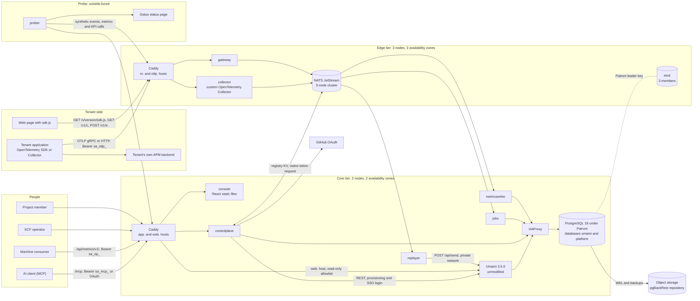
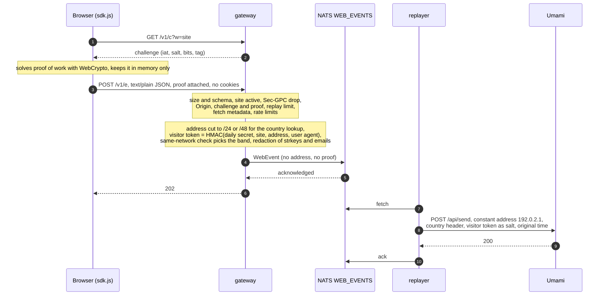
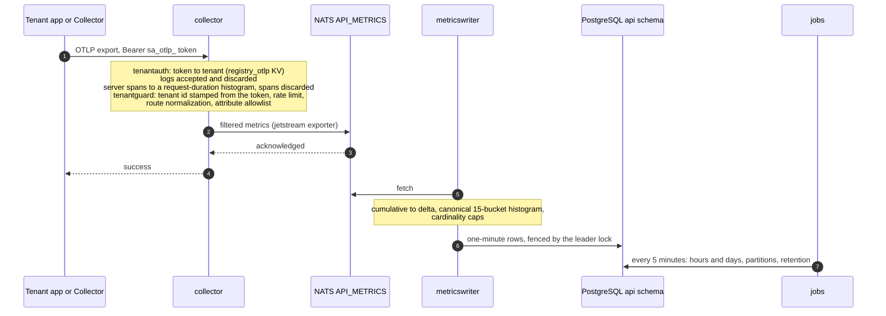
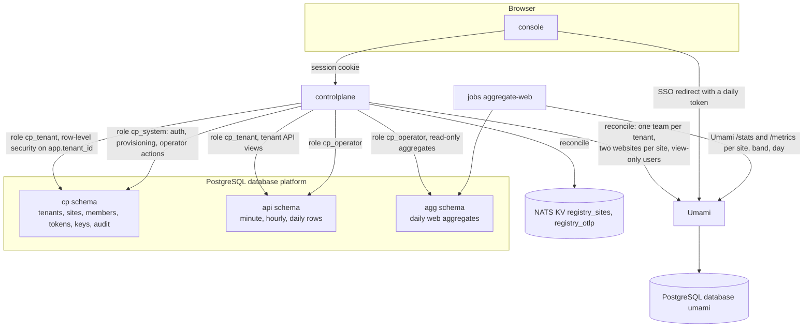
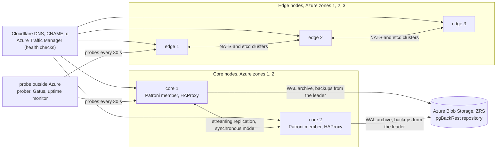

Veristar is a multi-tenant web and API analytics service. Web analytics are built on
an unmodified Umami 3.5.0. Everything the RFP needs beyond Umami (buffered ingestion, bot and
inflation checks, neutral endpoint names, OpenTelemetry ingest, tenancy, operator views) runs
in separate services beside it ([ADR 0001](adr/0001-base-platform.md),
[ADR 0002](adr/0002-overlay-not-fork.md)). Every diagram below names components that exist in
this repository; the paths in the tables point to them.

## Components and hosts

| Host | Serves | Tier | Code |
|---|---|---|---|
| `in.<BASE_DOMAIN>` | tracker files, challenge `GET /v1/c`, events `POST /v1/e` | edge | `deploy/caddy/edge.Caddyfile`, `internal/gateway` |
| `otlp.<BASE_DOMAIN>` | OTLP gRPC on 443 and OTLP HTTP `/v1/metrics`, `/v1/traces`, `/v1/logs` | edge | `collector/` |
| `app.<BASE_DOMAIN>` | the console, the control plane API under `/api`, the metrics API under `/api/metrics/v1/`, the MCP server at `/mcp` with its OAuth paths | core | `deploy/caddy/app.Caddyfile`, `apps/console`, `internal/controlplane` |
| `web.<BASE_DOMAIN>` | Umami's dashboard UI and read API, behind an allowlist, in the Veristar theme ([ADR 0004](adr/0004-umami-dashboard-theme.md)) | core | `deploy/caddy/web.Caddyfile`, `deploy/caddy/umami-theme`, [reference/umami-contract.md](reference/umami-contract.md) |
| `status.<BASE_DOMAIN>` | Gatus status page | probe | `infra/ansible/roles/observability` |

No host name or path uses a word that ad-block filter lists penalise (analytics, track,
collect, beacon, pixel, stats, metrics, event, data, umami); `tests/adblock` checks this
against current lists daily. Umami's own collect routes are never reachable from the internet.

| Component | Role | Code |
|---|---|---|
| gateway | checks and accepts web events, serves pinned tracker files, holds the only copy of client addresses (in memory, per request) | `cmd/gateway`, `internal/gateway` |
| collector | authenticates OTLP tokens, drops traces, spans and logs after deriving request histograms, normalizes routes, rate limits per tenant | `collector/` (three custom components) |
| replayer | delivers queued web events to Umami in order per visitor, at least once | `cmd/replayer`, `internal/replayer` |
| metricswriter | turns OTLP metric batches into one-minute PostgreSQL rows | `cmd/metricswriter`, `internal/metricswriter` |
| jobs | rollups, partitions, retention, web aggregates, gateway outcome counts, reconcile, daily Umami password rotation, domain checks, erasure follow-up | `cmd/jobs`, `internal/jobs/*` |
| controlplane | sign-in, tenants, sites, members, tokens, operator governance, operator views, metrics API, erasure | `cmd/controlplane`, `internal/controlplane` |
| console | the React single-page app for members and operators | `apps/console` |
| platformctl | database migrations and roles, NATS topology, Umami bootstrap | `cmd/platformctl` |
| prober, sloreport | end-to-end availability probes; monthly SLO report | `cmd/prober`, `cmd/sloreport` |

The edge accepts traffic with no dependency on PostgreSQL or Umami, so ingestion stays up
while the core tier is down ([reference/availability.md](reference/availability.md)).
Infrastructure is OpenTofu (`infra/tofu`) and Ansible (`infra/ansible`), see
[deploy/overview.md](deploy/overview.md).

## Web event flow

- The daily secret lives only in the memory-backed NATS bucket `edge_secrets` and is gone at
  the next UTC midnight, so stored sessions cannot be linked to a person afterwards
  ([compliance/privacy-strategy.md](compliance/privacy-strategy.md)).
- Each site has two Umami websites: the primary band and the quarantine band, for traffic
  from one network that shows more distinct visitors in an hour than `IPCLUSTER_THRESHOLD`
  allows ([operators/reading-the-numbers.md](operators/reading-the-numbers.md)).
- The proof raises the cost of forged traffic and rejects naive server-side posts; it does not
  prove a real browser ([security/bot-and-inflation.md](security/bot-and-inflation.md),
  [reference/browser-proof.md](reference/browser-proof.md)).
- Wire format: [reference/wire-v1.md](reference/wire-v1.md). Metric definitions:
  [reference/web-metrics.md](reference/web-metrics.md).

## API metrics flow

- Metric rows (`source = metric`) and span-derived rows (`source = span`) are stored apart at
  every resolution and never added ([reference/collector.md](reference/collector.md),
  [reference/api-storage.md](reference/api-storage.md)).
- Tenant identity always comes from the token; `service.name` is a sub-dimension inside a
  tenant.

## Control plane, tenancy and the operator view

- **Tenants** sign in with GitHub. Each tenant maps to one Umami team; each console user to one
  Umami user with view-only rights whose password is derived per UTC day and never stored. The
  tenant's web dashboard is Umami itself, reached by a single sign-on redirect.
- **Isolation**: every tenant-scoped request runs in a transaction with `app.tenant_id` set,
  under a role with row-level security forced on every tenant table. No application role can
  bypass it. The isolation gate `tests/isolation` checks every route and the role matrix in CI
  ([security/threat-model.md](security/threat-model.md)).
- **Operators** see aggregates only: the role `cp_operator` reads `agg`, hourly and daily `api`
  data and non-secret project facts, cannot read raw events or sessions, and cannot connect to
  the `umami` database. Operators get no Umami access
  ([operators/overview.md](operators/overview.md)).
- **Machine consumers** read the same aggregates with operator API keys under
  `/api/metrics/v1/`, which has no session handling at all
  ([operators/api-keys.md](operators/api-keys.md),
  [reference/openapi/metrics-v1.yaml](reference/openapi/metrics-v1.yaml)).
- **AI clients** connect to the MCP server at `/mcp` with an access key or an OAuth
  connection that acts as one console user, read-only, through the same read routes and
  checks as the console ([onboarding/mcp.md](onboarding/mcp.md),
  [security/mcp.md](security/mcp.md)).
- Full HTTP contract: [reference/control-plane-api.md](reference/control-plane-api.md).

## Queues and stores

| Object | Kind | Holds | Retention |
|---|---|---|---|
| `WEB_EVENTS` | stream, file, 3 replicas | accepted web events | until delivered, at most 72 h |
| `API_METRICS` | stream, file, 3 replicas | filtered OTLP metrics | until written, at most 7 days |
| `EDGE_STATS` | stream, file, 3 replicas | per-site outcome counters from gateways and the replayer | until counted, at most 7 days |
| `WEB_DLQ`, `API_DLQ` | stream | messages refused permanently downstream | 7 and 30 days |
| `registry_sites`, `registry_otlp` | KV, file | site and token state for the edge | rebuilt by reconcile |
| `edge_secrets` | KV, memory | daily visitor, network and proof secrets | until the next UTC midnight |
| `visit_state` | KV, memory | visit continuity and duplicate guard for the replayer | 24 h |
| `locks` | KV, memory | leader locks for replayer, metricswriter and jobs | 15 s |
| PostgreSQL `umami` | database | Umami's events and sessions | raw retention job `retain-web` |
| PostgreSQL `platform` | database | `cp`, `api`, `agg` schemas | API aggregates at least 24 months |

The topology is declared once in `internal/natsx/topology.go`. The database layout and roles
are in `db/migrations` and the design as summarised above.

## High availability and operations

- One NATS cluster and one etcd cluster span the three edge nodes. Patroni uses etcd for its
  leader key; HAProxy on each core node routes to the current leader.
- `replayer`, `metricswriter` and `jobs` run on both core nodes with one active instance each,
  chosen by leader locks in NATS. `metricswriter` and `jobs` write the lock revision into every
  transaction and abort if a newer leader wrote, so a paused former leader cannot write.
- Backups: pgBackRest on the database nodes archives WAL and takes scheduled full and
  differential backups from the Patroni leader to object storage. The local converge uses a
  separate repository node instead, because object storage does not exist there
  ([deploy/local-converge.md](deploy/local-converge.md)).
- Monitoring: Prometheus, Alertmanager and Grafana on the core nodes, the prober and Gatus on
  the probe node ([reference/observability.md](reference/observability.md),
  [runbooks/alerts.md](runbooks/alerts.md)). The observability role is built and tested on a
  local stack and is not yet applied by `site.yml`.
- Measured and configured failure windows, single points of failure and drill results:
  [reference/availability.md](reference/availability.md), [sla.md](sla.md).

## Supply chain

The tracker is released as immutable, versioned files with published SHA-384 integrity
hashes; tenants pin a version and upgrade on purpose, and a flawed version can be revoked so
the gateway answers 410 for it. The release pipeline scans, signs and attests every container
image, and a deployment refuses any image whose signature does not verify. Keyless signing in
the pipeline has not run yet, because GitHub Actions fails at startup on the account; the
deploy-time verification was proven with a test key. Details:
[security/supply-chain.md](security/supply-chain.md),
[security/verify-tracker.md](security/verify-tracker.md).
