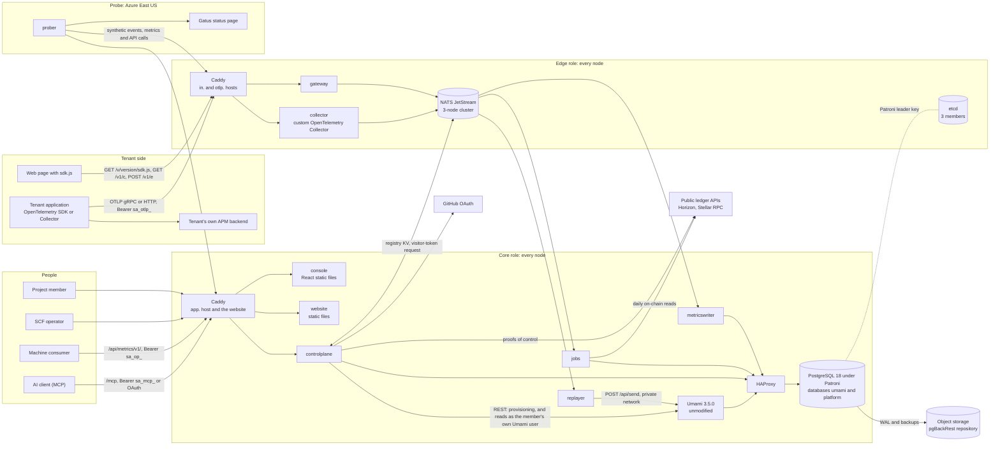
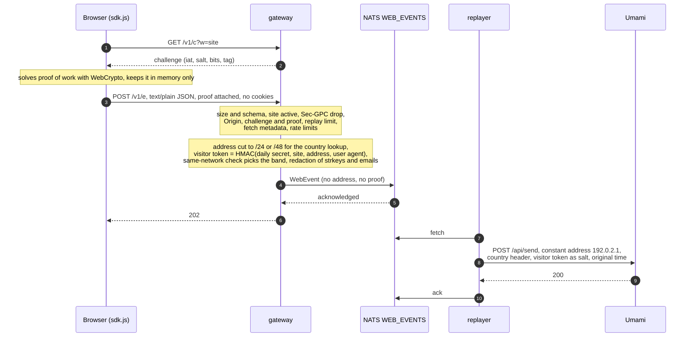
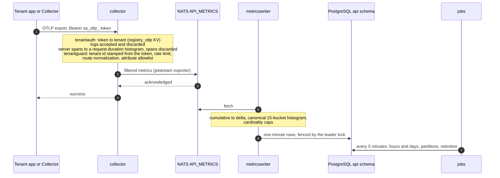
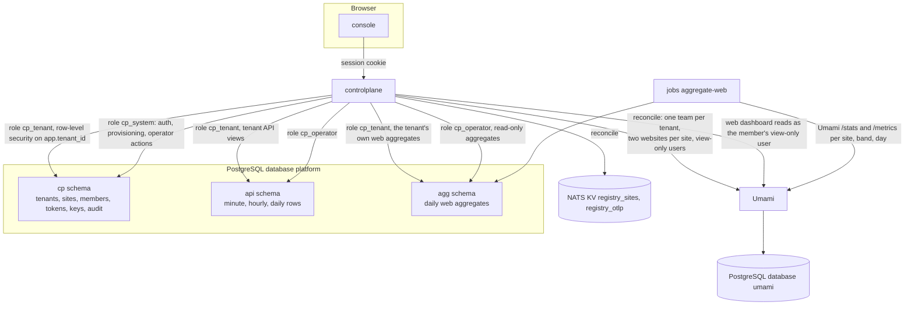
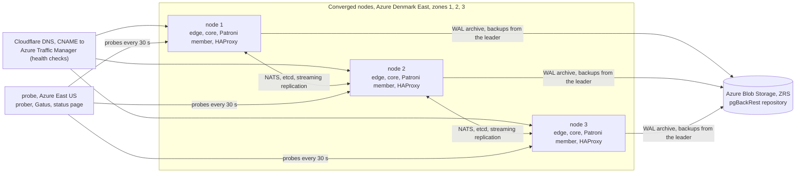

Veristar is a multi-tenant web, API and on-chain analytics service. Web analytics are built on
an unmodified Umami 3.5.0. Everything beyond Umami (buffered ingestion, bot and inflation
checks, neutral endpoint names, OpenTelemetry ingest, tenancy, operator views) runs in separate
services beside it ([ADR 0001](adr/0001-base-platform.md),
[ADR 0002](adr/0002-overlay-not-fork.md)). Every diagram below names components that exist in
this repository; the paths in the tables point to them.

## Components and hosts

| Host | Serves | Tier | Code |
|---|---|---|---|
| `in.<BASE_DOMAIN>` | tracker files, challenge `GET /v1/c`, events `POST /v1/e` | edge | `deploy/caddy/edge.Caddyfile`, `internal/gateway` |
| `otlp.<BASE_DOMAIN>` | OTLP gRPC on 443 and OTLP HTTP `/v1/metrics`, `/v1/traces`, `/v1/logs` | edge | `collector/` |
| `app.<BASE_DOMAIN>` | the console, the control plane API under `/api`, the metrics API under `/api/metrics/v1/`, the MCP server at `/mcp` with its OAuth paths | core | `deploy/caddy/app.Caddyfile`, `apps/console`, `internal/controlplane` |
| `<BASE_DOMAIN>` | the public website, static files only; `www.<BASE_DOMAIN>` redirects to it with 308 | core | `deploy/caddy/app.Caddyfile`, `apps/site` |
| `status.<BASE_DOMAIN>` | Gatus status page | probe | `infra/ansible/roles/observability` |

No host name or path uses a word that ad-block filter lists penalise (analytics, track,
collect, beacon, pixel, stats, metrics, event, data, umami); `tests/adblock` checks this
against current lists daily. No host serves Umami: the console's web dashboard reads it through
the control plane on the private network, and platform administrators reach its interface on a
node's loopback over SSH ([ADR 0005](adr/0005-umami-as-engine-only.md),
[operators/umami-admin-access.md](operators/umami-admin-access.md)).

| Component | Role | Code |
|---|---|---|
| gateway | checks and accepts web events, serves pinned tracker files, holds the only copy of client addresses (in memory, per request) | `cmd/gateway`, `internal/gateway` |
| collector | authenticates OTLP tokens, drops traces, spans and logs after deriving request histograms, normalizes routes, rate limits per tenant | `collector/` (three custom components) |
| replayer | delivers queued web events to the Umami processes of its own node, in order per visitor, at least once; every core node's replayer owns a share of the 32 web event partitions | `cmd/replayer`, `internal/replayer` |
| metricswriter | turns OTLP metric batches into one-minute PostgreSQL rows | `cmd/metricswriter`, `internal/metricswriter` |
| jobs | rollups, partitions, retention, web aggregates, integrity grades, on-chain daily reads, gateway outcome counts, reconcile, daily Umami password rotation, domain checks, session pruning, erasure follow-up | `cmd/jobs`, `internal/jobs/*` |
| controlplane | sign-in (GitHub, Stellar wallet, passkey), tenants, sites, members, tokens, on-chain ids and proofs, signed reports, operator roster and governance, operator views, metrics API, MCP server, erasure | `cmd/controlplane`, `internal/controlplane` |
| console | the React single-page app for members and operators | `apps/console` |
| platformctl | database migrations and roles, NATS topology, Umami bootstrap | `cmd/platformctl` |
| prober, sloreport | end-to-end availability probes; monthly SLO report | `cmd/prober`, `cmd/sloreport` |
| adoptionreport, issueage | adoption evidence per project, read from the metrics API; labels support issues that approach the response and resolution targets | `cmd/adoptionreport`, `cmd/issueage` |

The edge accepts traffic with no dependency on PostgreSQL or Umami, so ingestion stays up
while the core tier is down ([reference/availability.md](reference/availability.md)).
Infrastructure is OpenTofu (`infra/tofu`) and Ansible (`infra/ansible`), see
[deploy/overview.md](deploy/overview.md).

## Web event flow

- The daily secret lives only in the memory-backed NATS bucket `edge_secrets` and is gone at
  the next UTC midnight, so stored sessions cannot be linked to a person afterwards
  ([compliance/privacy-strategy.md](compliance/privacy-strategy.md)).
- Each site has two Umami websites: the primary band and the quarantine band, for traffic
  from one network that shows more distinct visitors in an hour than `IPCLUSTER_THRESHOLD`
  allows ([operators/reading-the-numbers.md](operators/reading-the-numbers.md)).
- The proof raises the cost of forged traffic and rejects naive server-side posts; it does not
  prove a real browser ([security/bot-and-inflation.md](security/bot-and-inflation.md),
  [reference/browser-proof.md](reference/browser-proof.md)).
- Wire format: [reference/wire-v1.md](reference/wire-v1.md). Metric definitions:
  [reference/web-metrics.md](reference/web-metrics.md).

### Web event partitions

The gateway queues each event on `web.events.<site id>.<partition>`. The partition, `00` to
`31`, is a hash of the site id and the visitor token (`events.Partition`), so all of a
visitor's events are in one partition. Each partition has its own durable consumer
(`replayer-p00` to `replayer-p31`) and its own lock in the `locks` bucket.

- **Ownership.** Each replayer announces itself with a member key in `locks`. From the member
  list every replayer computes the same assignment, 11, 11 and 10 partitions on three nodes, and
  contends only for its own. The lock decides who consumes, so a partition never has two owners,
  even while two replayers briefly see different member lists. A partition whose lock stays
  free for 10 s is taken by any replayer.
- **Hand-over.** A replayer that stops, or whose partition is assigned to a node that joined,
  stops fetching, delivers what it holds and releases the lock; the next owner starts at once.
  A killed replayer's partitions are free when their locks expire (15 s), and the next owner
  waits until the killed one's unacknowledged messages can be redelivered (at most the 30 s ack
  wait), so a visitor's events reach Umami in order through node loss and rolling deploys.
- **Delivery.** Each replayer sends to the Umami processes of its own node. Every process shares
  the one database and `APP_SECRET`, so which node stores an event does not change what is
  stored ([reference/umami-contract.md](reference/umami-contract.md) item 14). Visit continuity
  (`visit_state`) and the duplicate guard (`sent.<event id>`) stay correct because one owner
  handles a visitor at a time.
- **Why 32.** It splits three nodes 11, 11 and 10, divides evenly over 1, 2, 4 and 8 nodes, and
  keeps the per-partition cost small: each partition is a replicated consumer and a lock renewed
  every 5 s.
- **Upgrade from the single subject.** Earlier releases queued on `web.events.<site id>`; the
  replayer drains that subject under the `replayer` lock until `platformctl nats
  retire-legacy-web` removes it ([deploy/upgrade.md](deploy/upgrade.md), "Upgrading to
  partitioned web events").

## API metrics flow

- Metric rows (`source = metric`) and span-derived rows (`source = span`) are stored apart at
  every resolution and never added ([reference/collector.md](reference/collector.md),
  [reference/api-storage.md](reference/api-storage.md)).
- Tenant identity always comes from the token; `service.name` is a sub-dimension inside a
  tenant.

## Control plane, tenancy and the operator view

- **Tenants** sign in with GitHub, a Stellar wallet or a passkey. Each tenant maps to one Umami team; each console user to one
  Umami user with view-only rights whose password is derived per UTC day and never stored. The
  tenant's web dashboard is a console page: totals, days and the referrer, country and
  environment breakdowns come from the daily aggregates operators read too; pages, events, UTM
  values, hours and the visitors right now come from Umami, read by the control plane as the
  member's own Umami user, so Umami's team check guards those reads a second time
  ([reference/control-plane-api.md](reference/control-plane-api.md) section 18).
- **Isolation**: every tenant-scoped request runs in a transaction with `app.tenant_id` set,
  under a role with row-level security forced on every tenant table. No application role can
  bypass it. The isolation gate `tests/isolation` checks every route and the role matrix in CI
  ([security/threat-model.md](security/threat-model.md)).
- **Operators** see aggregate numbers, plus each project's enrollment answers, members and
  audit log for review: the role `cp_operator` reads `agg`, hourly and daily `api` data and
  non-secret project facts, cannot read raw events or sessions, and cannot connect to the
  `umami` database. Operators get no Umami access
  ([operators/overview.md](operators/overview.md)).
- **Machine consumers** read the same aggregates with operator API keys under
  `/api/metrics/v1/`, which has no session handling at all
  ([operators/api-keys.md](operators/api-keys.md),
  [reference/openapi/metrics-v1.yaml](reference/openapi/metrics-v1.yaml)).
- **AI clients** connect to the MCP server at `/mcp` with an access key or an OAuth
  connection that acts as one console user, read-only, through the same read routes and
  checks as the console ([onboarding/mcp.md](onboarding/mcp.md),
  [security/mcp.md](security/mcp.md)).
- Full HTTP contract: [reference/control-plane-api.md](reference/control-plane-api.md).

## Queues and stores

| Object | Kind | Holds | Retention |
|---|---|---|---|
| `WEB_EVENTS` | stream, file, 3 replicas | accepted web events, in 32 partitions by visitor | until delivered, at most 72 h |
| `API_METRICS` | stream, file, 3 replicas | filtered OTLP metrics | until written, at most 7 days |
| `EDGE_STATS` | stream, file, 3 replicas | per-site outcome counters from gateways and the replayer | until counted, at most 7 days |
| `WEB_DLQ`, `API_DLQ` | stream | messages refused permanently downstream | 7 and 30 days |
| `registry_sites`, `registry_otlp` | KV, file | site and token state for the edge | rebuilt by reconcile |
| `edge_secrets` | KV, memory | daily visitor, network and proof secrets | until the next UTC midnight |
| `visit_state` | KV, memory | visit continuity and duplicate guard for the replayer | 24 h |
| `locks` | KV, memory | leader locks for metricswriter and jobs, partition locks and member keys of the replayer | 15 s |
| PostgreSQL `umami` | database | Umami's events and sessions | raw retention job `retain-web` |
| PostgreSQL `platform` | database | `cp`, `api`, `agg` schemas | API aggregates at least 24 months |

The NATS topology is declared once in `internal/natsx/topology.go`. The database layout and
roles are in `db/migrations`.

## High availability and operations

- Staging and production run three converged nodes, one per availability zone: every node is in
  the edge and the core inventory groups and runs every service
  ([reference/availability.md](reference/availability.md)). The local converge can also run a
  split layout of three edge and two core nodes ([deploy/local-converge.md](deploy/local-converge.md)).
- One NATS cluster and one etcd cluster have one member on each node. Patroni (three members:
  leader, synchronous standby, replica) uses etcd for its leader key; HAProxy on each node
  routes to the current leader.
- `replayer` runs on every node, and every instance delivers the web event partitions it owns
  ("Web event partitions" above). `metricswriter` and `jobs` run on every node with one active
  instance each, chosen by leader locks in NATS. `metricswriter` and `jobs` write the lock revision into every
  transaction and abort if a newer leader wrote, so a paused former leader cannot write. A
  rolling deploy stops `jobs` on every node before the migrations, so no daemon of the earlier
  release writes under a schema it does not know.
- Backups: pgBackRest on the database nodes archives WAL and takes scheduled full and
  differential backups from the Patroni leader to zone-redundant Azure Blob Storage
  ([deploy/backups.md](deploy/backups.md)). The local converge uses a separate repository node
  in place of object storage ([deploy/local-converge.md](deploy/local-converge.md)).
- Monitoring: Prometheus, Alertmanager and Grafana on the nodes; the prober and Gatus on a
  separate virtual machine in Azure East US, which serves the public status page
  `status.<BASE_DOMAIN>` ([deploy/probe.md](deploy/probe.md),
  [reference/observability.md](reference/observability.md), [runbooks/alerts.md](runbooks/alerts.md)).
  `site.yml` applies the observability role on every node, and firing alerts appear on the
  console's operator Alerts page, the alert channel ([operators/alerts.md](operators/alerts.md)).
- Measured and configured failure windows, single points of failure and drill results:
  [reference/availability.md](reference/availability.md), [sla.md](sla.md).

## Supply chain

The tracker is released as immutable, versioned files with published SHA-384 integrity
hashes; tenants pin a version and upgrade on purpose, and a flawed version can be revoked so
the gateway answers 410 for it. Every container image of a release is scanned, given an SBOM
and signed with cosign, and every playbook that deploys refuses an image whose signature does
not verify. Details:
[security/supply-chain.md](security/supply-chain.md),
[security/verify-tracker.md](security/verify-tracker.md).
