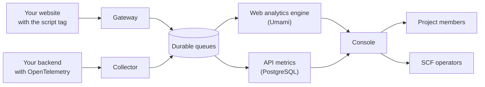

Veristar has two inputs, one for websites and one for backends, and one console where project
members and operators read the results. This page follows each path at a high level. The
[architecture](/architecture) page has the full detail, with every service and store.

## Web analytics

<Steps>
  <Step title="The page loads a pinned script">
    Your pages include one script tag that loads a specific, released version of the tracker,
    `sdk.js`. The browser checks the file against the tag's integrity value, so the code your
    visitors run is exactly the released file.
  </Step>
  <Step title="The browser solves a small challenge">
    Before sending events, the tracker solves a small proof of work issued by the server. It
    raises the cost of forged traffic and turns away simple server-side posts
    ([browser proof](/reference/browser-proof)).
  </Step>
  <Step title="The gateway checks and anonymises each event">
    The gateway checks the event's size, origin, proof and rate limits. It derives the country
    from a shortened address and a visitor token from a secret that changes every UTC day. The
    address itself is kept in memory for the request only and is never stored.
  </Step>
  <Step title="Events are queued, then delivered">
    Accepted events wait in a replicated queue, so ingestion keeps working even while the
    dashboards are being maintained. A replayer then delivers them to Umami, the open-source
    analytics engine that stores the events and computes the metrics. Umami is reachable on the
    private network only.
  </Step>
  <Step title="You read your dashboard">
    Members open **Web** in their project in the console and see page views, visitors, visits,
    bounce rate, visit duration, referrers, countries, devices, pages and custom events for any
    range of days, against the previous period, with the visitors right now
    ([web metrics](/reference/web-metrics)).
  </Step>
</Steps>

## API analytics

<Steps>
  <Step title="Your app exports twice">
    Your backend keeps sending its OpenTelemetry data to the tools you already use, and adds a
    second exporter that sends a copy to Veristar with a project token.
  </Step>
  <Step title="The collector keeps only what the dashboards need">
    The collector identifies your project from the token, turns server spans into request
    counts and latency histograms per route, and discards traces, spans and logs on arrival
    ([what gets dropped](/onboarding/api/what-gets-dropped)).
  </Step>
  <Step title="Metrics are stored as compact aggregates">
    A writer stores one-minute rows, and scheduled jobs roll them up into hourly and daily rows
    that are kept for at least 24 months.
  </Step>
  <Step title="You read the API dashboard">
    The console shows request volume, status codes and latency percentiles per service, method
    and route.
  </Step>
</Steps>

## Projects and operators

Each project is a tenant. Members sign in with GitHub and see only their own project's data:
every request runs under database row-level security for that project. SCF operators see
aggregates across projects, never raw events or sessions, and machine consumers can read the
same aggregates through the [metrics API](/operators/api-keys).

## Privacy throughout

- No cookies are set and no IP address is stored.
- Visitors are counted per UTC day with a secret that is destroyed at midnight, so stored data
  cannot later be linked to a person.
- Email addresses and Stellar account keys are redacted from events before anything is queued.

The [privacy strategy](/compliance/privacy-strategy) describes what is held in memory, queued and
stored, and for how long.
