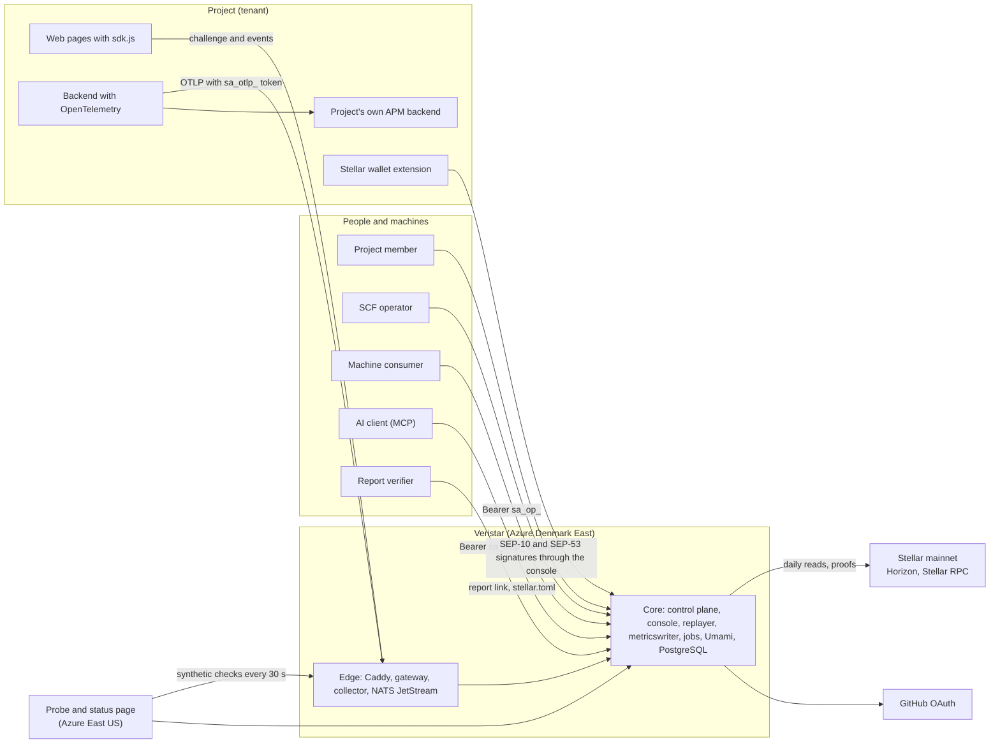
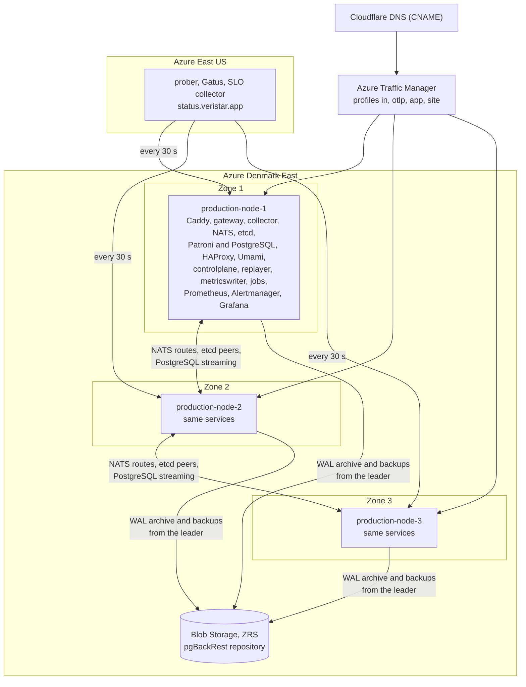
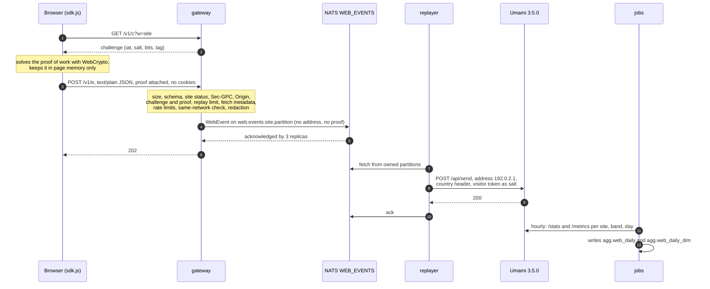
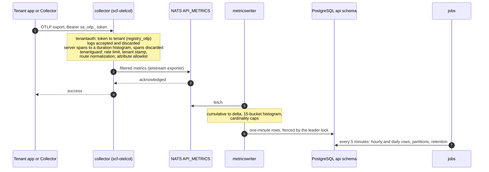
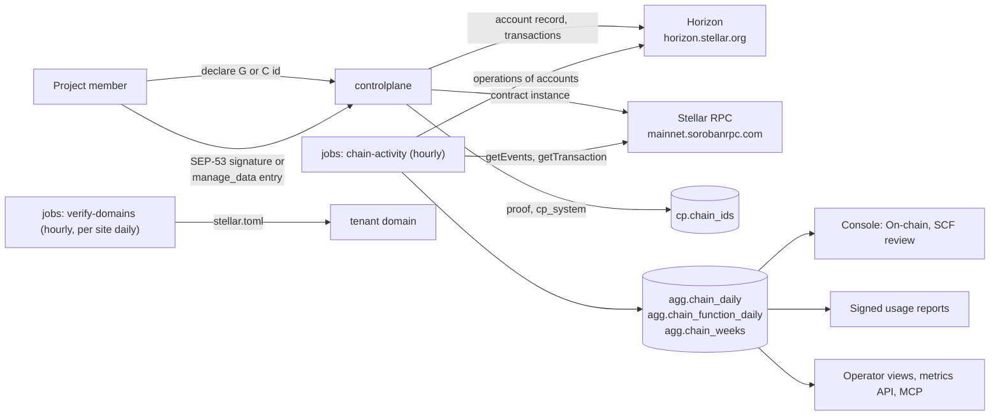
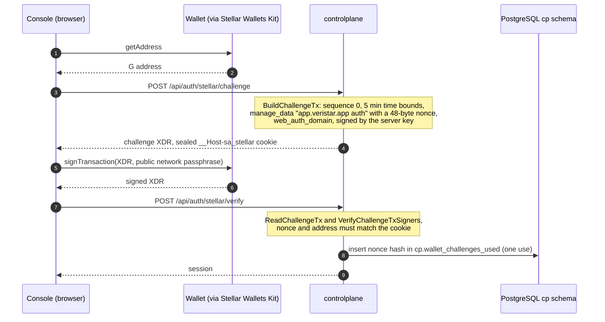
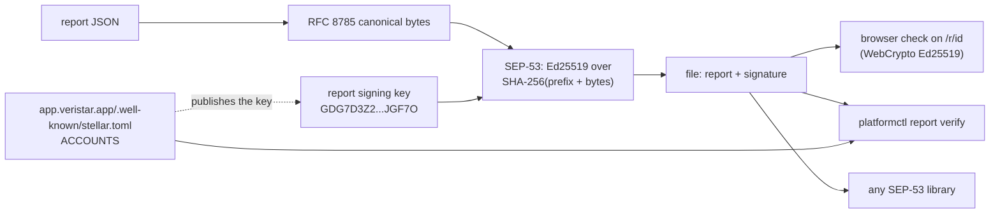

Version of this document: 2026-11-20. It describes release `v0.4.5` (2026-11-19) of the
monorepo `https://github.com/justmert/veristar` (Apache License 2.0; the tracker package is MIT).

All paths in this document are relative to the repository root. Each section names the source
files and documents that hold the full detail. The documentation site
`https://docs.veristar.app` publishes the `docs/` folder of the repository.

## 1. Purpose and scope

Veristar is a multi-tenant analytics service for every project built on Stellar. It measures
three kinds of usage with one method for every project:

- **Web usage.** A project adds a version-pinned script tag to its site. The service counts page
  views, visitors, visits, bounce rate, visit duration, referrers, countries, devices, browsers
  and custom events. It sets no cookies and stores no IP addresses.
- **API usage.** A project adds a second OpenTelemetry exporter to its backend. The service keeps
  request counts, status codes and latency histograms per normalized route and stores them in
  PostgreSQL for at least 24 months.
- **On-chain usage.** A project declares its Stellar accounts and Soroban contracts and proves
  that it controls them. A daily job reads their activity from Horizon and Stellar RPC.

Each project reads its own data in a private console. A project can also create a usage report
for a period. The service signs the report with a published Stellar key. Anyone can verify the
report without an account: a grant program such as SCF, an investor or a partner.

The service runs as a shared service for the Stellar ecosystem. Stellar Community Fund (SCF)
operators approve and remove projects. They compare projects in a cross-project view that is
built from aggregates only. Operators never see individual visitors.

The service charges no fees to anyone (`docs/compliance/terms.md` section 2).

### Live endpoints

| Host | Purpose |
|---|---|
| `https://veristar.app` | public website (static files) |
| `https://app.veristar.app` | console, control plane API (`/api`), machine metrics API (`/api/metrics/v1/`), MCP server (`/mcp`), signed report pages (`/r/<id>`), the service's `/.well-known/stellar.toml` |
| `https://in.veristar.app` | tracker files (`/v/<version>/sdk.js`), challenge (`GET /v1/c`), events (`POST /v1/e`) |
| `https://otlp.veristar.app` | OTLP gRPC and OTLP HTTP (`/v1/metrics`, `/v1/traces`, `/v1/logs`) |
| `https://status.veristar.app` | public status page, served from outside the production region |
| `https://docs.veristar.app` | documentation |

### Base platform

Web analytics run on an unmodified Umami 3.5.0. The RFP requires Umami or GoatCounter.
`docs/adr/0001-base-platform.md` records the choice. Umami computes bounces and visit time
natively, stores its data in PostgreSQL and is MIT licensed. Veristar runs Umami as an engine
only, beside its own services, not as a fork (`docs/adr/0002-overlay-not-fork.md`,
`docs/adr/0005-umami-as-engine-only.md`). No public host serves Umami.

---

## 2. Stellar integration overview

Veristar uses Stellar standards and APIs for its data sources, sign-in, proofs of control,
signatures, redaction and instrumentation. Every row below exists in the code of release
`v0.4.5`.

### 2.1 Integrations from the SCF Integration List

The SCF Build Integration List
(`https://stellar.gitbook.io/scf-handbook/scf-awards/build-award/integration-track/integration-list`)
names three building blocks that Veristar uses.

| List entry (category) | How Veristar uses it | Code path | Status |
|---|---|---|---|
| **Stellar Wallets Kit** (Wallet Integration, Wallet Connection Layers) | 1. Console sign-in with a Stellar wallet (SEP-10 challenge signed through the kit). 2. Proof of account control with a SEP-53 signed message through the kit. 3. Operator roster identities by Stellar address. 4. Optional tracker capture of `wallet_selected`, `wallet_connected` and `wallet_disconnected` events from the kit on tenant dapps. Pinned version `@creit.tech/stellar-wallets-kit` 2.8.0 (`pnpm-workspace.yaml`); the tracker capture is tested against kit 2.7.1 and 2.8.0. | `apps/console/src/lib/stellar-wallet/index.ts`, `apps/console/src/lib/stellar-wallet/modules.ts`, `packages/tracker/src/wallets-kit.ts`, `examples/wallets-kit-spa`, `tests/webpath` (`TestWalletsKit`) | Built, in production |
| **Freighter Connect** (Wallet Integration, Wallet Connection Layers) | Freighter is now named Varial. The console loads the kit's `VarialModule`, which calls `@stellar/freighter-api` (`getAddress`, `signTransaction`, `signMessage`). Freighter (Varial) users sign in and sign SEP-53 proofs with it. | `apps/console/src/lib/stellar-wallet/modules.ts` (`import("@creit.tech/stellar-wallets-kit/modules/varial")`) | Built, in production |
| **Anchor Platform** (On / Off-Ramping, Fiat Gateways and Anchor Integrations) | API analytics for anchors without a change to the Anchor Platform. The OpenTelemetry Java agent 2.33.1 instruments the SEP server and the platform server of Anchor Platform 5.0.0. Veristar receives `http.server.request.duration` per SEP route (for example `/sep24/transactions/deposit/interactive`, `/auth`, `/transactions/{id}`). | `docs/onboarding/api/anchor-platform.md`, `examples/otel-anchor-platform`, `tests/otelapps` (`TestAnchorPlatform`) | Built, documented and tested end to end |

### 2.2 Stellar standards and APIs

| Integration | Standard or API | What it does | Code path |
|---|---|---|---|
| Account activity reads | Horizon `/accounts/{id}/operations`, account records, transactions | Daily operations, transactions, counterparties and initiating accounts of each declared `G` account; home domain and data entries; deployer proof transactions | `internal/chain/horizon.go`, `internal/chain/reader.go`, `internal/jobs/chainactivity` |
| Contract activity reads | Stellar RPC `getEvents`, `getTransaction`, `getLedgerEntries`, `getLedgers`, `getHealth` | Daily activity of each declared `C` contract, initiating accounts, calls per contract function from envelopes and diagnostic events, contract instance storage for admin proofs | `internal/chain/rpc.go`, `internal/chain/functions.go`, `internal/chain/initiators.go`, `internal/chain/contract.go` |
| Weekly active accounts | SCF Growth Hack definition: "the account that initiated at least one operation" | Distinct initiating `G` accounts per ISO week over a project's verified ids | `internal/jobs/chainactivity` (`weeks.go`), `docs/reference/onchain-sources.md` |
| Wallet sign-in | SEP-10 Stellar Web Authentication | Challenge transaction built and verified with `txnbuild.BuildChallengeTx`, `ReadChallengeTx`, `VerifyChallengeTxSigners`; public network only; one use | `internal/controlplane/auth/stellar.go` |
| Proof of account control | SEP-53 Sign and Verify Messages | Ed25519 signature over `SHA-256("Stellar Signed Message:\n" + message)`; account must still be controlled by its master key | `internal/chain/sep53.go`, `internal/controlplane/onchain/verify.go` |
| Proof of account control (alternative) | `manage_data` operation | Data entry named `veristar` with the challenge nonce, read through Horizon | `internal/controlplane/onchain/verify.go` |
| Proof of contract control | Soroban contract instance storage; contract deployment transactions | Admin address under `Admin`, `admin`, `Owner` or `owner`; or contract id recomputed from deployer and salt of the creating transaction | `internal/chain/contract.go`, `internal/controlplane/onchain/verify.go` |
| Domain to ledger link | SEP-1 `stellar.toml` (`ACCOUNTS`, `[DOCUMENTATION] ORG_URL`, `[[CURRENCIES]]`, `NETWORK_PASSPHRASE`) | Reads each verified site domain's `stellar.toml` daily; checks the two-way link with the account's `home_domain` | `internal/controlplane/domaincheck/stellartoml.go`, `internal/jobs/verifydomains` |
| Signed usage reports | SEP-53 over RFC 8785 canonical JSON; signing key published in SEP-1 `ACCOUNTS` | Service signs reports; browser, CLI and any SEP-53 library verify them | `internal/controlplane/reports`, `apps/console/src/lib/report-verify.ts`, `cmd/platformctl` (`report verify`) |
| Passkey sign-in | soropass smart accounts on Soroban (`@soropass/core` 0.3.1) | WebAuthn ES256 credential whose key is the founding signer of a soropass contract account; the console derives the `C` address offline | `internal/controlplane/passkey/passkey.go`, `apps/console/src/lib/passkey` |
| Strkey recognition and redaction | SEP-23 strkeys (all ten types), SEP-2 federation addresses | Replaces Stellar ids and secret seeds in web events and API routes with fixed placeholders | `internal/redact/redact.go`, `internal/routenorm/routenorm.go` |
| Address validation | strkey checksums through `github.com/stellar/go-stellar-sdk` v0.9.0 | Validates `G`, `M` and `C` ids at enrollment, `G` and `C` ids on the On-chain page, `G` addresses for wallet sign-in and the roster | `internal/controlplane/onchain/routes.go`, `internal/controlplane/auth/stellar.go` |

### 2.3 Service window plan

The repository documents the plan for the 12-month service window that starts when SCF approves
the final development tranche:

- The original operator hosts the service and gives support for the full 12 months, with the
  targets in section 13.5 and section 16.
- A monthly SLO report records the measured availability (`docs/sla.md`, `cmd/sloreport`).
- Stewardship moves to a community-appointed operator between month 6 and month 12, at SCF's
  discretion (`docs/handover/plan.md`). Section 16 gives the phases.

The Stellar integrations above are built and run in production. The service window covers the
system that this document describes.

---

## 3. System context and deployment topology

### 3.1 System context



### 3.2 Deployment topology

Production runs in Microsoft Azure, region Denmark East (`denmarkeast`, EU). The OpenTofu code is
`infra/tofu/envs/production/main.tf`.

- **Three converged nodes**, one in each availability zone 1, 2 and 3. Each node is a
  `Standard_B2as_v2` virtual machine (2 vCPUs, 8 GB) with a 128 GB StandardSSD OS disk and the
  Debian 13 image. Each node runs every service of the edge and the core. Every service therefore
  has one member in each zone (`docs/reference/availability.md`).
- **Azure Traffic Manager** answers DNS for each hostname with every healthy node address
  (routing method MultiValue). Four profiles exist (`infra/tofu/modules/failover`):

  | Profile | Hostnames | Health path on port 80 | Probe interval | Answer TTL |
  |---|---|---|---|---|
  | `in` | `in.veristar.app` | `/` (edge health) | 10 s | 10 s |
  | `otlp` | `otlp.veristar.app` | `/` (edge health) | 10 s | 10 s |
  | `app` | `app.veristar.app` | `/core` (dashboard health) | 30 s | 30 s |
  | `site` | `veristar.app`, `www.veristar.app` | `/site` (Caddy) | 30 s | 30 s |

  A healthy node answers 308 on port 80, an unhealthy one 503. Each profile tolerates two failed
  probes.
- **Cloudflare DNS** holds the zone, in DNS-only mode. Traffic goes straight to Azure. Each
  hostname is a CNAME to its Traffic Manager profile with a TTL of 300 s; Cloudflare flattens the
  apex and `www`. A CAA record allows `letsencrypt.org` only (`infra/tofu/modules/dns`).
- **Backups** go to zone-redundant Azure Blob Storage in the same region
  (account `veristarprodbackups`, container `pgbackrest`).
- **The probe** runs on a separate virtual machine in Azure East US, outside the production
  region. It runs the prober, Gatus and the SLO collector, and serves `status.veristar.app`
  (`docs/deploy/probe.md`).



### 3.3 Components

| Component | Role | Code |
|---|---|---|
| Caddy 2.11.9 (custom build) | TLS termination for every public host; tracker files; website; reverse proxy | `deploy/caddy/`, `deploy/images/caddy.Dockerfile` |
| gateway | checks and accepts web events; serves pinned tracker files; holds the only copy of client addresses, in memory, per request | `cmd/gateway`, `internal/gateway` |
| collector (`scf-otelcol`) | OpenTelemetry Collector distribution with three custom components: authenticates OTLP tokens, drops traces, spans and logs, normalizes routes, publishes metrics | `collector/` |
| NATS JetStream 2.15.3 | durable queues (3 replicas) and key-value buckets | `internal/natsx/topology.go` |
| etcd 3.7.4 | Patroni leader key store, 3 members | `infra/ansible/roles/edge` |
| replayer | delivers queued web events to Umami | `cmd/replayer`, `internal/replayer` |
| Umami 3.5.0 (unmodified) | stores web events and sessions, computes web metrics; private network only | `infra/ansible/vars/pins.yml` |
| metricswriter | writes OTLP metric batches as one-minute PostgreSQL rows | `cmd/metricswriter`, `internal/metricswriter` |
| jobs | rollups, partitions, retention, web aggregates, integrity grades, on-chain reads, domain checks, reconcile, Umami password rotation, session pruning, erasure follow-up | `cmd/jobs`, `internal/jobs/*` |
| controlplane | sign-in, tenancy, sites, tokens, on-chain ids and proofs, signed reports, operator views, metrics API, MCP server, erasure | `cmd/controlplane`, `internal/controlplane` |
| console | React single-page app for members and operators | `apps/console` |
| website | static public site | `apps/site` |
| PostgreSQL 18.7 under Patroni 4.1.5, HAProxy 3.4.7, pgBackRest 2.60.0 | databases `umami` and `platform`; leader routing; backups | `deploy/images/postgres-ha.Dockerfile`, `infra/ansible/roles/core`, `infra/ansible/roles/backup` |
| platformctl | migrations, roles, NATS topology, Umami bootstrap, report verification, queue forwarder | `cmd/platformctl` |
| prober, sloreport | availability probes; monthly SLO report | `cmd/prober`, `cmd/sloreport` |

The edge accepts traffic without PostgreSQL or Umami. Ingestion therefore stays up while the core
tier is down (`docs/reference/availability.md`).

No hostname or path uses a word that common ad-block filter lists block (analytics, track,
collect, beacon, pixel, stats, metrics, event, data, umami). `tests/adblock` checks the names
against current filter lists (`docs/architecture.md`).

---

## 4. Web analytics path

### 4.1 Flow



### 4.2 Tracker and version pinning

- The tracker is `packages/tracker` (MIT, derived from Umami's tracker). The current release is
  1.4.0: 10,231 bytes, 4,641 bytes gzip, released 2026-11-18
  (`packages/tracker/releases/manifest.json`).
- Each release is an immutable file at `https://in.veristar.app/v/<version>/sdk.js`. There is no
  `latest` alias. Files carry `Cache-Control: public, max-age=31536000, immutable`.
- The snippet carries a SHA-384 subresource integrity value. For 1.4.0 the value is
  `sha384-8bYExYW1FMGfNg5LETdGYFjtJPLfyY+gJQwWA0rL5xNM7Xl+3wK99GxSV3+siv/A`. The SHA-384 of the
  file served live on 2026-11-20 equals this value.
- A tenant upgrades on purpose by changing the version and the hash. A flawed version can be
  revoked (`packages/tracker/releases/revoked.json`). The gateway then answers 410 for the file
  and for events that name that version.
- Anyone can rebuild a release byte for byte (`docs/security/verify-tracker.md`).
- Integration guides exist for static HTML, Vite and React, Next.js, React Router, Astro,
  SvelteKit, Vue, VitePress, Docusaurus and Mintlify, plus npm, consent mode, custom events,
  Content Security Policy and self-hosting (`docs/onboarding/web/`). Each framework guide has a
  working example under `examples/`.

### 4.3 Browser proof

The browser proof raises the cost of forged traffic and refuses plain server-side posts
(`docs/reference/browser-proof.md`, `docs/security/bot-and-inflation.md` section 4).

1. Once per page load, the tracker calls `GET /v1/c?w=<site id>`.
2. The gateway answers `{w, iat, salt, bits, tag}`. `salt` is 16 random bytes.
   `tag = HMAC-SHA256(proof_key, w|iat|salt|bits)`. The daily proof key is in the memory bucket
   `edge_secrets`.
3. The tracker finds a `nonce` such that `SHA-256(w|iat|salt|nonce)` has at least `bits` leading
   zero bits. `PROOF_BITS` is 12: the highest tested value with a median solve under 150 ms at a
   6x CPU slowdown in Chromium, Firefox and WebKit.
4. The gateway refuses a proof older than 6 hours, more than 30 s in the future, with a wrong tag,
   or with too little work. One proof carries at most 50 queued events per node
   (`PROOF_REPLAY_LIMIT`).

### 4.4 Gateway checks

The gateway (`internal/gateway`) runs these checks on each `POST /v1/e`
(`docs/reference/gateway-limits.md`, `docs/architecture.md`):

| Check | Setting or rule |
|---|---|
| Body size | `GATEWAY_MAX_BODY` 8,192 bytes, else 413 |
| Site status | unknown or inactive site, 404 |
| Global Privacy Control | `Sec-GPC: 1` answers 204 and drops the event |
| Origin | must be an allowed origin of the site, else 403 |
| Challenge and proof | section 4.3, else 403 |
| Fetch metadata | `Sec-Fetch-Site`, `Sec-Fetch-Mode` and `Sec-Fetch-Dest` must hold the values that the tracker's `fetch` produces in Chromium, Firefox and WebKit, else 403 |
| Rate limits per node | per site 200/s, burst 400; per site and keyed hash of the /24 or /48, 20/s, burst 60; the same limits apply to `GET /v1/c` in separate buckets |
| Visitor volume | 600 queued events per site and visitor token per hour (`VISITOR_EVENTS_PER_HOUR`); later events go to the quarantine band |
| Same-network check | distinct visitor tokens per site and truncated prefix per hour; floor `IPCLUSTER_THRESHOLD` 20; events past the threshold go to the quarantine band |
| Redaction | Stellar strkeys, secret seeds, email and federation addresses in every text field (`internal/redact`) |
| Queue | 202 only after the JetStream acknowledgement; 503 when the queue is unavailable |

Umami's own `isbot` check runs on the visitor's original `User-Agent`, which the replayer forwards
unchanged (`docs/security/bot-and-inflation.md` section 3).

Each site has two Umami websites: the primary band and the quarantine band. The quarantine band
keeps suspect traffic visible but apart from the headline numbers
(`docs/operators/reading-the-numbers.md`).

### 4.5 Client address handling at the gateway

- Caddy sets one header, `X-Edge-Client-Ip`. The gateway reads the address from it and keeps it in
  memory for the request only (`docs/compliance/privacy-strategy.md` section 3).
- Country: the gateway looks up the /24 (IPv4) or /48 (IPv6) network in the local DB-IP Country
  Lite file. Only the ISO country code leaves the gateway.
- Network class: the gateway looks up the network in the local DB-IP ASN Lite file and an
  autonomous system category table, and compares the address with a local Tor exit list. Only a
  count per class and site leaves the request.
- Visitor token: `vt = hex(HMAC-SHA256(daily_secret, site_id || 0x00 || ip || 0x00 || user_agent))`.
  The secret is 32 random bytes per UTC day. It exists only in the memory bucket `edge_secrets`,
  with a TTL that ends at the next UTC midnight.

### 4.6 Queue, partitions and replayer

- The gateway publishes each event to `web.events.<site id>.<partition>` in the stream
  `WEB_EVENTS` (file storage, 3 replicas, retention until delivered and at most 72 hours).
- The partition (`00` to `31`) is a hash of the site id and the visitor token. All events of one
  visitor are in one partition.
- Each partition has its own durable consumer (`replayer-p00` to `replayer-p31`) and its own lock
  in the `locks` bucket. On three nodes the replayers own 11, 11 and 10 partitions.
- A partition has one owner at a time. A new owner waits until the unacknowledged messages of the
  previous owner can be redelivered (at most the 30 s ack wait). The events of a visitor therefore
  reach Umami in order through node loss and rolling deploys.
- The replayer sends each event to the Umami processes of its own node with the constant address
  `192.0.2.1` (TEST-NET-1), the country in a header and the visitor token as Umami's client salt.
  Umami's session id therefore depends on the token and never on a real address.
- `visit_state` (memory bucket, 24 h) keeps visit continuity. `sent.<event id>` keys guard
  against duplicates.
- Messages that Umami refuses permanently go to `WEB_DLQ` (7 days).

Detail: `docs/architecture.md`, "Web event partitions".

### 4.7 Aggregates and metrics

- The jobs task `aggregate-web` reads Umami's `/stats` and `/metrics` per site, band and UTC day
  and writes `agg.web_daily` and `agg.web_daily_dim`. It reads today and the three days before
  again each run.
- Members see page views, visitors, visits, bounce rate, visit duration, referrers, countries,
  devices, browsers, operating systems, pages, custom events, UTM values and the visitors right
  now, for any day range, against the previous period (`docs/reference/web-metrics.md`).
- Visitors are unique per UTC day and site. Totals over a range are sums of daily visitors.

### 4.8 Stellar Wallets Kit event capture

Capture is opt-in per site, with one attribute (`data-wallets-kit="true"`) or one call
(`attachWalletsKit`) (`docs/onboarding/web/wallets-kit.md`).

| Event | Sent when | Data |
|---|---|---|
| `wallet_selected` | the visitor picks a wallet in the kit | `wallet`: the kit's wallet id |
| `wallet_connected` | the kit goes from no address to an address | `network`: `public`, `testnet`, `futurenet` or `other` (npm mode only) |
| `wallet_disconnected` | the visitor disconnects through the kit | none |

- The account address is never sent, hashed or stored. The capture only checks whether an address
  exists.
- Script-tag mode reads the names of `localStorage` keys, the value of
  `@StellarWalletsKit/selectedModuleId`, and the presence of `@StellarWalletsKit/activeAddress`.
  It never reads the address value.
- npm mode subscribes to the kit's own events (`STATE_UPDATE`, `WALLET_SELECTED`, `DISCONNECT`).
- `TestWalletsKit` (`tests/webpath`) runs both modes in a real browser through the real gateway
  into Umami. It checks that the address appears in no request body, queue message or database
  row.
- The events appear in the **Custom events** panel of the project's **Web** page.

---

## 5. API analytics path

### 5.1 Flow



### 5.2 Dual export

The tenant application keeps its own APM exporter and adds a second exporter to
`otlp.veristar.app` with a project token (`sa_otlp_` and 40 base62 characters). The token comes
from the console's **Connect API** page. Guides exist for Go, Node, Python, Java, Rust, a
Collector fan-out and the Stellar Anchor Platform (`docs/onboarding/api/`).

### 5.3 Collector

The collector is an OpenTelemetry Collector distribution built with ocb 0.165.0 (core v0.165.0 and
v1.71.0, contrib v0.165.1) (`collector/builder-config.yaml`, `docs/reference/collector.md`).

```
traces:        otlp -> memory_limiter -> tenantguard -> signal_to_metrics (connector)
metrics/spans: signal_to_metrics -> memory_limiter -> transform/spans -> jetstream
metrics:       otlp -> memory_limiter -> tenantguard -> transform/tenant -> jetstream
logs:          otlp -> memory_limiter -> tenantguard -> nop
```

| Custom component | Function |
|---|---|
| `tenantauth` (`collector/tenantauthextension`) | Looks up the hashed token in a snapshot of the NATS KV bucket `registry_otlp`. Only `active` tokens pass. It fails closed until the first snapshot is loaded. |
| `tenantguard` (`collector/tenantguardprocessor`) | Rate limits per tenant (production: 50 requests/s, burst 100; 50,000 items/s, burst 200,000 per collector process). Reduces the resource to `service.name`, tenant id and token id. Keeps `http.server.request.duration` and `http.server.duration` histograms only. Keeps the attributes `http.request.method`, `http.route`, `http.response.status_code`, `error.type` and the traffic class. Keeps SERVER spans with an HTTP method and discards their content. Discards logs. |
| `jetstream` (`collector/jetstreamexporter`) | Publishes filtered metrics per tenant to the stream `API_METRICS`. |

The tenant id always comes from the token. Forged `tenant.id` or `scf.*` attributes are dropped.
`service.name` is a dimension inside a tenant.

The `signal_to_metrics` connector turns kept server spans into the histogram
`scf.http.server.request.duration.from_spans`. Metric rows (`source = metric`) and span rows
(`source = span`) are stored apart and never added (`docs/reference/api-storage.md`).

Traffic classes separate application requests from CORS preflights, health routes and probes.
Headline numbers count `traffic_class = 'app'` only (`internal/trafficclass`).

### 5.4 Route normalization, with Stellar addresses

The rule set is hard-coded, ordered and versioned (version 2). Tenants cannot configure it. A
tenant that needs finer control sets `http.route` in its own middleware
(`internal/routenorm/routenorm.go`, `docs/onboarding/api/http-route.md`).

1. Drop the query and fragment, collapse repeated slashes, remove a trailing slash.
2. Percent-decode each segment once.
3. Replace Stellar strkeys (SEP-23): `G` to `{account}`, `M` to `{muxed}`, `C` to `{contract}`,
   `W` to `{muxed_contract}`, `L` to `{pool}`, `B` to `{balance}`, `T` to `{preauth}`, `X` to
   `{hashx}`, `P` to `{signed_payload}`, `S` to `{redacted-secret}`.
4. Replace federation addresses with `{federation}` and email addresses with `{email}`.
5. Replace `CODE:ISSUER` and `CODE-ISSUER` assets with `{asset}`.
6. Replace whole segments: 64 hex to `{hash}`, UUID to `{uuid}`, ULID to `{ulid}`, `0x` hex to
   `{hex}`, integers to `{id}`, other hex of 16 or more characters to `{hex}`, ISO dates to
   `{date}`, JWTs and long base64url strings to `{token}`.
7. Replace any remaining segment longer than 64 bytes with `{long}`.

Version 2 adds `{invalid}` for invalid UTF-8, `{id}` for digit runs inside a segment, `{text}` for
free text, and a 512-byte route limit.

Strkey recognition (`internal/redact/redact.go`) checks the CRC16 checksum, the version byte and
the length of each candidate, and then calls `strkey.DecodeAny` of `go-stellar-sdk`. A shape
alone never matches. The tests use the SEP-23 v1.4.0 vectors. A secret seed in a route sets a flag
and never reaches storage.

### 5.5 Metrics writer and storage

The metricswriter (`internal/metricswriter`) converts cumulative points to deltas, maps every
histogram onto 15 canonical buckets, applies cardinality caps and writes one-minute rows. One
active instance runs at a time, chosen by a leader lock in NATS. Each transaction carries the lock
revision. A former leader that resumes after a pause cannot write.

| Item | Value |
|---|---|
| Canonical bucket bounds (seconds) | 0.005, 0.01, 0.025, 0.05, 0.075, 0.1, 0.25, 0.5, 0.75, 1, 2.5, 5, 7.5, 10, plus an open bucket above 10 s |
| Row key | tenant, bucket start, service, method, route, status code, source, traffic class |
| Daily caps per tenant | 300 routes (`METRICSWRITER_ROUTE_CAP`), 50 services (`METRICSWRITER_SERVICE_CAP`); the rest is stored as `{other}` |
| `api.metrics_minute` | partitioned by day, kept 30 days (`API_MINUTE_RETENTION_DAYS`) |
| `api.metrics_hourly` | partitioned by month, kept 36 months in production (`API_HOURLY_RETENTION_MONTHS`; values below 24 are refused) |
| `api.metrics_daily` | not partitioned, kept forever |
| Percentiles | `api.histogram_quantile(q, api.sum_buckets(counts))` over summed buckets; percentiles are never averaged |
| Duplicates | `api.ingest_dedup` keyed by `Nats-Msg-Id` |
| Refused messages | `API_DLQ`, 30 days |

The console's **API** page shows request volume, status codes and p50, p95 and p99 latency per
service, method and route.

---

## 6. On-chain path

The on-chain witness is section 15 of `docs/reference/control-plane-api.md`. User guide:
`docs/onboarding/onchain.md`. Sources and limits: `docs/reference/onchain-sources.md`.



### 6.1 Declaring ids

- A project declares up to 20 ids (`MaxIDs`, `internal/controlplane/onchain/routes.go`). An id is a
  `G` account or a `C` contract. Strkey checksums are verified with `go-stellar-sdk`.
- A muxed `M` address is refused on the On-chain page. Its activity is the activity of its `G`
  account, which the project adds. Enrollment accepts `G`, `M` and `C` ids and does not copy `M`
  ids to the declared list.

### 6.2 Proof of control

Only verified ids count in any figure an operator ranks, compares or grades, and in signed
reports. Anyone can declare a public id, so an unproven id adds nothing to them.

| Method | For | How it works |
|---|---|---|
| `sep53` | account | The console creates a challenge, valid for 30 minutes. The message names the console host, the project name and id, the account, a nonce and the expiry. The wallet signs it the SEP-53 way through the Stellar Wallets Kit. The control plane verifies the Ed25519 signature (`chain.VerifySEP53`). It then reads the account through Horizon. The master key weight must be above 0 and at least the medium threshold, so an old key of a locked account cannot claim it. |
| `manage_data` | account | The account submits a `manage_data` operation named `veristar` with the challenge value. The control plane reads the account's data entries through Horizon. This method serves wallets that cannot sign messages and multisig accounts. |
| `contract_admin` | contract | The control plane reads the contract instance with `getLedgerEntries`. The address under `Admin`, `admin`, `Owner` or `owner` must be a verified account of the project. |
| `contract_deployer` | contract | The member gives the creating transaction hash. The control plane reads it through Horizon, recomputes the contract id from the deploying address and the salt, and requires the deployer to be a verified account of the project. A contract created by a factory during a contract call is reported as such; the admin method proves it. |

A challenge works once. A failed attempt keeps an earlier proof. Every attempt writes an audit
row. A contract proof rests on the account it was proven through. Removing that account clears
the proof.

### 6.3 Daily reads

The jobs task `chain-activity` runs hourly and reads every completed UTC day that is not yet read
(`internal/jobs/chainactivity`).

| Source (default) | Rate | Used for |
|---|---|---|
| Horizon, `https://horizon.stellar.org` (`STELLAR_HORIZON_URL`) | 0.8 requests/s (`STELLAR_HORIZON_RPS`) | account operations, account records, deployer transactions, ledger close times |
| Stellar RPC, `https://mainnet.sorobanrpc.com` (`STELLAR_RPC_URL`) | 2 requests/s (`STELLAR_RPC_RPS`) | `getEvents`, `getTransaction` (batches of 10), `getLedgerEntries`, `getLedgers`, `getHealth` |

| Kind | Operations | Transactions | Counterparties |
|---|---|---|---|
| Account | successful operations that involve the account | distinct transactions of those operations | distinct other `G` accounts the operations name |
| Contract | distinct (transaction, operation) pairs with an event the contract emitted in a successful call | distinct transactions with such an event | distinct `G` and `C` addresses in the event topics |

- The first read of an account covers the last 90 days. Public RPC servers keep 120,960 ledgers
  (about seven days), so a contract's history starts at most a week before it is declared.
- The reader finds the first ledger of a day by binary search over ledger close times. It starts
  100 ledgers above the RPC server's oldest ledger.
- A day is stored only when it was read whole. An id with more than 20,000 operations (accounts)
  or 50,000 events (contracts) in one run records `day_over_read_cap` for the rest.
- Requests retry on 429 and 5xx with exponential backoff and jitter, and respect `Retry-After`.
  After six attempts the id records `rate_limited` or `source_unavailable`. The next hourly run
  retries it.
- A day that could not be read shows its reason. It never shows as zero.

### 6.4 Weekly active accounts

The SCF Growth Hack official rules define an active account as "the account that initiated at
least one operation". Veristar applies this definition to a project's verified ids: the weekly
active accounts of an ISO week (Monday to Sunday, UTC) are the distinct `G` accounts that
initiated at least one successful operation that involves a verified account or contract of the
project.

- For an account, the initiator is the operation's source account. Horizon returns the base `G`
  account of a muxed source.
- For a contract, the initiator is the source of each operation with an event of the contract.
  For a fee bump, it is the inner transaction's source, never the fee payer.
- While a week is open, the platform holds a random 32-byte key for the project and week. It
  stores `HMAC-SHA256(key, account)` for each initiator, never the address. When the week closes,
  it stores the count and deletes the hashes and the key.
- A week counts only when each verified id has all seven days read. An unfinished week closes
  with its reason 14 days after its Monday.

### 6.5 Calls per contract function

For each verified contract, the platform counts calls per function, per UTC day and per kind of
caller (section 15.9 of `docs/reference/control-plane-api.md`).

| Caller | Read from |
|---|---|
| `account` | `envelopeXdr`: the `invoke_host_function` operation whose host function is `invoke_contract` with the contract as `contract_address` |
| `contract` | `diagnosticEventsXdr`: `fn_call` and `fn_return` diagnostic events form the call tree |

- A call without a `fn_return` before the next event of its caller failed. The calling contract
  handled the error.
- Distinct calling accounts are counted in memory. No address and no hash is stored.
- At most 64 functions per contract and day keep their own rows. The rest add up under `{other}`.
- The unit tests decode mainnet transactions as `getTransaction` returned them on 2026-11-17
  (`internal/chain/testdata`). One fixture is transaction
  `9ab4a86a900cb2d5ec61fc77b1a86962acef14e74679b7c9d88bb868122a361d` at ledger 65,520,023: a
  router `deposit` calls a pool `deposit`, and two `balance` calls fail with contract error 13
  that the pool handles.
- `internal/chain/live_test.go` reads the default sources with production code under the build
  tag `live`.

### 6.6 SEP-1 two-way link

SEP-1 links a domain and its accounts in both directions. Veristar checks both legs from a
verified site domain (section 15.5 of `docs/reference/control-plane-api.md`).

1. **Domain to ledger.** `https://<domain>/.well-known/stellar.toml` lists the account in
   `ACCOUNTS` and sets `[DOCUMENTATION] ORG_URL` to an https URL on the same domain or its `www.`
   form. The file must be for the public network. Veristar reads the first 50 entries of
   `ACCOUNTS` and of `[[CURRENCIES]]`.
2. **Ledger to domain.** The account's `home_domain` on the ledger is the domain.

- A site domain is verified first, with a DNS TXT record at `_veristar.<domain>` or the file
  `https://<domain>/.well-known/veristar.txt` (`internal/controlplane/domaincheck/verify.go`).
- Every fetch from a tenant domain goes through `internal/netguard`, which fetches HTTPS files
  from public hosts only and refuses other addresses and redirects it does not allow. The file
  limit is 100 KiB (the SEP-1 limit of the Go SDK). The request deadline is 10 s.
- The jobs task `verify-domains` re-reads `stellar.toml` once a day per site. The home domain is
  read with each daily ledger read.
- An unverified account never links, because anyone can declare an account that lists a domain.
- `stellartoml-live.yml` runs the live `stellar.toml` test daily.

### 6.7 What is stored

The platform stores the declared ids, the proof of each (method, time, and the transaction hash or
storage key a contract proof used), each account's home domain, three counts per id and day, one
weekly active account count per week, and the calls per function per day. It stores no
counterparty address, no transaction and no signature. The requests to the ledger APIs carry the
public ids only.

---

## 7. Control plane

The control plane (`cmd/controlplane`, `internal/controlplane`) serves the console API, the
machine metrics API and the MCP server on `app.veristar.app`. The full HTTP contract is
`docs/reference/control-plane-api.md`.

### 7.1 Sign-in

| Method | Mechanism | Code |
|---|---|---|
| GitHub | OAuth with no scope; the console receives the numeric user id and the login only | `internal/controlplane/auth/endpoints_github.go` |
| Stellar wallet | SEP-10 challenge, signed through the Stellar Wallets Kit | `internal/controlplane/auth/stellar.go` |
| Passkey | soropass passkey: a WebAuthn ES256 credential that is also the signer of a Stellar smart account | `internal/controlplane/auth/passkey.go`, `internal/controlplane/passkey` |

Several methods can link to one console account.



SEP-10 details (`internal/controlplane/auth/stellar.go`):

- The challenge is bound to the console host (operation name and `web_auth_domain`), to the
  public network passphrase only, to the browser (nonce and address in the sealed
  `__Host-sa_stellar` cookie) and to one use (`cp.wallet_challenges_used`).
- The server signing key is derived from `OAUTH_STATE_KEY` with HKDF and its own label. It is
  separate from every other key.
- A challenge expires after five minutes. It is never submitted to the network and moves no
  funds.
- The console offers browser extension wallets that work under its security headers: Varial
  (formerly Freighter), xBull, LOBSTR, Hana, Rabet, Klever, OneKey, Bitget Wallet, Cactus Link,
  D'CENT, Fordefi and Scopuly (`docs/onboarding/sign-in.md`). The xBull module calls the
  extension's API directly, because the kit's xBull module bundles an AGPL-3.0 library.

Passkey details (`internal/controlplane/passkey/passkey.go`):

- The control plane checks `clientDataJSON` (type, challenge, origin), the relying party id hash,
  the user present and user verified flags, and the ECDSA P-256 signature.
- It derives the smart account's `C` address offline, the way the soropass account factory on the
  public network deploys it. The address is the identity only. The console does not deploy the
  account or send anything to the network.

Sessions last 7 days at most and end after 24 hours idle (jobs task `session-prune`).

### 7.2 Tenancy and isolation

Each project is a tenant. Isolation uses PostgreSQL row-level security
(`docs/reference/control-plane-api.md` section 1.3, `docs/security/threat-model.md`).

| Role | Used for | Access |
|---|---|---|
| `cp_tenant` | every tenant-scoped request | runs in a transaction with `app.tenant_id` set; row-level security is forced on every tenant table |
| `cp_operator` | operator views | reads `agg`, hourly and daily `api` data and non-secret project facts; cannot read raw events or sessions; cannot connect to the `umami` database |
| `cp_system` | sign-in, provisioning, operator actions, proofs | cannot update or delete `cp.audit_log` |

- No application role has `BYPASSRLS`.
- Every route under `/api/tenants/{tenant_id}` and `/api/sites/{site_id}` checks membership first.
  A non-member gets 404, also for ids that exist.
- Triggers limit what `cp_tenant` can change: for example, a site's status can only change to
  `removed`, and an audit row must name the session user (migrations `00024` and `00028`).
- Each tenant maps to one Umami team. Each console user maps to one view-only Umami user. Its
  password is derived per UTC day and never stored. The control plane reads live web data from
  Umami as the member's own Umami user, so Umami's team check guards those reads a second time.
- The isolation gate `tests/isolation` checks every route and the role matrix. It runs on every
  push to `main` and every pull request (`ci.yml`, job `isolation`).

### 7.3 Enrollment modes

The operator setting `enrollment_mode` controls enrollment (`docs/operators/review-and-enrollment.md`).

| Mode | New project | Its sites |
|---|---|---|
| `open` (default) | `active` at once | provisioned in Umami and accepted by the gateway after reconcile |
| `approval` | `pending`, in the review queue | nothing provisioned; the gateway refuses their events as `rejected_unknown_site` |

- A switch applies to the next enrollment without a restart. It never changes existing projects.
  Each switch writes `settings.enrollment_mode` to the audit log.
- Enrollment asks for the website, how the project uses Stellar, optional Stellar ids, an optional
  SCF round link, and acceptance of the current terms. A user creates at most 10 projects per day.
- A site whose domain equals, is a subdomain of, or is a parent of the domain of a removed
  project's site goes to review, also in `open` mode.
- Operators see two signals per site in review: domain verification and the SEP-1 `stellar.toml`
  link. Neither gates ingestion.

### 7.4 Removal and purge

An operator removes a project in the console or with `platformctl tenant remove`. A reason is
required (`docs/operators/removal.md`). Suspension is the reversible alternative.

At once, in one transaction, the project and its sites become `removed` and `tenant.remove` is
written to the audit log. The jobs task `reconcile` then purges the stores in this order, with
each step audited as `purge.step`:

| Step | Effect |
|---|---|
| `registry` | the gateway refuses new events for every site |
| `otlp_tokens` | every OTLP token is revoked |
| `umami` | both Umami websites of every site, with all raw events and sessions; then the Umami team; then Umami users of members with no other project |
| `web_ingest` | network keys always; gateway counters unless aggregates are kept |
| `api` | minute rows always; hourly and daily rows unless aggregates are kept |
| `agg` | daily web aggregates, grades and coverage unless aggregates are kept |
| `chain` | read state, week members and open weeks always; daily ledger counts, calls per function and closed weeks unless aggregates are kept |
| `reports` | every signed usage report of the project |

A failed step retries on the next reconcile, at most 10 minutes later. The operator setting
"Daily totals of removed projects" decides whether anonymous daily counts stay.

### 7.5 Operators

- The roster (`cp.operators`) lists operator identities: a GitHub account, a wallet `G` address or
  a passkey account `C` address. Roles are operator and operator admin
  (`docs/operators/roster.md`).
- `OPERATOR_GITHUB_IDS` and `OPERATOR_STELLAR_ADDRESSES` add operator admins at every start of the
  control plane. They are the lockout recovery path.
- The roster always keeps at least one active operator admin.
- Every operator confirms the operator area with a passkey or a security key, on top of sign-in.
  The step-up repeats after `OPERATOR_STEP_UP_MAX_AGE` (12 hours by default).
- Operator pages: Review, Alerts, All projects (Web and API views), Compare, Rules, Settings,
  Operators, Access keys, Audit log.

### 7.6 Operator API keys and the metrics API

Machine consumers read aggregates at `https://app.veristar.app/api/metrics/v1/`
(`docs/operators/api-keys.md`, `docs/reference/openapi/metrics-v1.yaml`).

| Setting | Value |
|---|---|
| Format | `sa_op_` and 40 characters; shown once; only SHA-256 and the first 10 characters are stored |
| Scope | `metrics:read`, for every tenant or for one tenant |
| Lifetime | 90 days by default, at most 365 |
| Rate | 10 requests/s per key and control plane instance, burst 20 |
| Page size | 500 items |
| Ranges | at most 366 days; 744 hours for `/api/hourly`; 24 hours for `/web/hourly` |

Operators create and revoke keys on the **Access keys** page or with
`POST /api/operator/api-keys`. Creation and revocation are in the audit log.

### 7.7 MCP read access

The control plane serves a Model Context Protocol endpoint at `https://app.veristar.app/mcp`
(`docs/security/mcp.md`, section 12 of `docs/reference/control-plane-api.md`).

- Every tool is read-only. Project tools call the console's read routes in process, behind a
  router that passes `GET` only.
- Credentials: an access key (`sa_mcp_` and 40 base62 characters, 1 to 365 days, 90 by default)
  or an OAuth connection (access token 1 hour, refresh token 30 days, rotated on every use).
- The control plane is its own OAuth authorization server (RFC 8414) and protected resource
  (RFC 9728). Clients register dynamically (RFC 7591) and use PKCE with S256. Tokens are
  audience-bound (RFC 8707).
- A credential acts as one console user. Membership and project status are read again on every
  request. Removal of a member or suspension of a project revokes the credential through database
  triggers (migration `00030`).
- Umami's own MCP endpoint stays disabled.

### 7.8 Audit log and terms

- Every action writes a row to `cp.audit_log`. `cp_system` cannot update or delete it. Operators
  read the log on the **Audit log** page, filtered by project, action, actor, target and time, with
  a text search (migration `00052`).
- The terms of use are `docs/compliance/terms.md`, version `2026-11-19.1`, status `final`.
  `GET /api/terms` answers the current version. Every project owner accepts a new version at the
  next sign-in. Changes to a project are blocked until an owner accepts. Erasure is never blocked.

---

## 8. Console

The console (`apps/console`) is a React 19.3.1 single-page app built with Vite 8.3.8. Caddy serves
it as static files on `app.veristar.app`.

| Area | Pages |
|---|---|
| Project | Overview, Web, API, On-chain, SCF review, Sites, Connect API, AI assistants, Members, Privacy |
| Operator | Review, Alerts, All projects, Compare, Rules, Settings, Operators, Access keys, Audit log |
| Public | sign-in, terms, signed report page (`/r/<id>`), MCP consent |

- **SCF review** shows a project the same figures the operator views show about it: integrity
  grade, cohort, percentiles, rules met, web, API and on-chain columns, weekly active accounts and
  calls per function. It also creates signed reports.
- **On-chain** shows activity, the declared ids with their proof status, and the `stellar.toml`
  link checklist. **Export CSV** downloads the daily rows.
- The console sends strict security headers. The live response of `app.veristar.app` carries
  `Content-Security-Policy: default-src 'none'` with a hashed inline script, `base-uri 'none'`,
  `form-action 'none'` and `frame-ancestors 'none'`.
- The wallet picker is a console component. The console drives the kit through its module API
  and not through the kit's modal, because the modal adds a `<style>` element that the console's
  `style-src 'self'` policy refuses.

---

## 9. Signed usage reports and integrity grades

### 9.1 Integrity grades

The jobs task `integrity` runs hourly. It grades today and the three days before it for every site
(`docs/security/bot-and-inflation.md` section 9, `internal/integrity/grade.go`). Each day starts at
grade A. Each rule can only lower the grade.

| Code | Lowers to | When |
|---|---|---|
| `hosting_share` | B / C | 25% / 50% of classified events come from hosting networks or anonymisers |
| `quarantine_share` | B / C | 10% / 30% of accepted events went to the quarantine band |
| `few_networks` | B | at least 100 visitors and fewer than one network per 100 visitors |
| `spike` | B | at least 100 visitors and 10 times the baseline median, with 7 or more baseline days |
| `proof_failures` | B | half or more of the challenge-backed requests failed their proof |
| `page_volume` | B | 50 or more page views per visitor |
| `framed_share` | B / C | from 50 page views of trackers that report signals, 25% / 50% inside a frame (rule version 2) |
| `never_visible_share` | B | from 50 page views and notices, 30% loaded and never visible (rule version 2) |

A project can appeal a grade through the console's **Appeal this grade** link, which opens a
GitHub issue form.

### 9.2 Signed usage reports

A project creates a report on its **SCF review** page (`docs/onboarding/signed-reports.md`,
`docs/reference/usage-reports.md`, section 20 of `docs/reference/control-plane-api.md`).

- A report covers whole UTC days, at most 366, and ends four days before today at the latest. The
  service reads today and the three days before it again, so only older days are final.
- A project creates at most 20 reports per 24 hours.
- A report holds aggregates only: web totals and daily series, API totals and percentiles,
  on-chain counts of verified ids, weekly active accounts, calls per contract function, the
  integrity grade with its reasons, the cohort with percentiles, and the threshold rules met. It
  holds no visitor, address, user agent or member.
- `methods` records the version of every definition behind the numbers (`web_metrics` 1,
  `api_metrics` 2, `onchain` 2, `cohort` 1, `integrity_rules` 2, `route_normaliser` 2). The
  current format version is 3.
- Each report has a link `https://app.veristar.app/r/<id>` with an id nobody can guess. A project
  can revoke the link. Views and revocations are in the audit log.

### 9.3 Signature and verification



- The report is serialized with the JSON Canonicalization Scheme (RFC 8785). Every number is an
  integer within plus or minus 2^53 - 1. Ratios, percentiles and latencies are decimal strings
  with six digits.
- The signature is SEP-53: Ed25519 over `SHA-256("Stellar Signed Message:\n" + canonical bytes)`.
- The production signing key is `GDG7D3Z267FHK3JHVPXF5SHTSQFEDLWYKEI5ECMSLDGKJUXPXZOJGF7O`. It
  holds no funds and signs nothing else. It is published in three places:
  `https://app.veristar.app/.well-known/stellar.toml` under the SEP-1 field `ACCOUNTS` (checked
  live on 2026-11-20), the status page, and `docs/reference/usage-reports.md`.
- SEP-1's `SIGNING_KEY` field is not used, because SEP-1 reserves it for SEP-10 and SEP-45
  authentication servers.
- A replaced key stays in `ACCOUNTS` after the current key, so earlier reports still verify.
- `platformctl report verify report.json` checks the signature and requires the signer to be
  listed in the `stellar.toml` whose address is built into `platformctl`. It never trusts a key or
  an address that the report names. Exit codes: 0 valid, 1 invalid, 2 check not run.
- The report page checks the signature in the visitor's browser with WebCrypto
  (`apps/console/src/lib/report-verify.ts`).

### 9.4 Cohorts and threshold rules

- A project owner proposes its SCF program, round, category and award date. An operator confirms
  them. Percentiles are computed inside the cohort with `cume_dist`. A percentile shows only in a
  cohort of 5 projects or more (`docs/onboarding/signed-reports.md`).
- A threshold rule states a traction requirement once, for example verified visitors per day with
  a minimum integrity grade. The console lists every project that meets it, with the evidence
  (`docs/operators/threshold-rules.md`).

---

## 10. Data stores and schemas

### 10.1 NATS JetStream

The topology is declared once in `internal/natsx/topology.go`. Each node's NATS server has a
20 GB file store (`edge_nats_max_file_store`).

| Object | Kind | Holds | Retention |
|---|---|---|---|
| `WEB_EVENTS` | stream, file, 3 replicas | accepted web events in 32 partitions | until delivered, at most 72 h |
| `API_METRICS` | stream, file, 3 replicas | filtered OTLP metrics | until written, at most 7 days |
| `EDGE_STATS` | stream, file, 3 replicas | per-site outcome counters from gateways and the replayer | until counted, at most 7 days |
| `WEB_DLQ`, `API_DLQ` | stream | messages refused permanently downstream | 7 and 30 days |
| `registry_sites`, `registry_otlp` | KV, file | site and token state for the edge | rebuilt by reconcile |
| `edge_secrets` | KV, memory | daily visitor, network and proof secrets | until the next UTC midnight |
| `visit_state` | KV, memory | visit continuity and duplicate guard | 24 h |
| `locks` | KV, memory | leader locks and partition locks | 15 s |

### 10.2 PostgreSQL

PostgreSQL 18.7 runs under Patroni with two databases. The `platform` schema is in
`db/migrations` (52 migrations in release `v0.4.5`).

| Database, schema | Content |
|---|---|
| `umami` | Umami's events and sessions (27 migrations of the pinned Umami 3.5.0 image) |
| `platform.cp` | tenants, users, members, invites, sessions, sites, OTLP tokens, operators, operator passkeys, operator API keys, MCP credentials and OAuth state, chain ids, wallet challenge nonces, usage reports, cohorts, threshold rules, settings, erasure requests, tenant removals, gateway counters (`web_ingest_hourly`, `web_evidence_daily`, `web_networks_daily`, `web_signals_daily`), audit log, leader fence |
| `platform.api` | `metrics_minute`, `metrics_hourly`, `metrics_daily`, writer state (`series_state`, `resource_seen`, `ingest_dedup`, `route_registry`, `rollup_pending`), `ingest_warnings`, `traffic_class_rules` |
| `platform.agg` | `web_daily`, `web_daily_dim`, `web_integrity_daily`, `web_coverage_daily`, `chain_daily`, `chain_function_daily`, `chain_reads`, `chain_weeks`, `chain_week_members` |

Retention per store is in section 11.3.

---

## 11. Privacy design

The full strategy is `docs/compliance/privacy-strategy.md`. Related documents: `dpia.md`,
`records-of-processing.md`, `jurisdictions.md`, `data-residency.md`, `erasure.md`,
`dpa-template.md` and `subprocessors.md` in `docs/compliance/`.

### 11.1 Principles in the code

- **No cookies.** The tracker sets no cookie and uses no browser storage beyond reading the
  opt-out flag `umami.disabled`. The challenge stays in page memory.
- **No stored IP address.** The address exists in gateway memory for one request. Only the
  country code, a network class count and keyed hashes leave the request.
- **Daily secret.** Visitor tokens use a 32-byte secret per UTC day that exists only in memory
  and expires at midnight. After midnight nobody, the operator included, can recompute a token or
  link a stored session to a person.
- **Global Privacy Control.** The gateway drops events with `Sec-GPC: 1` (answer 204).
- **Consent mode.** With `data-auto-track="false"` the tracker sends nothing until the site calls
  `umami.start()` (`docs/onboarding/web/consent.md`).
- **Minimal page data.** The tracker sends the page address, referrer host and hostname. The
  gateway drops the query string unless the site collects UTM parameters. Tracker 1.4.0 never
  reads the screen size or the browser language.
- **Redaction.** Stellar strkeys, secret seeds, email and federation addresses are replaced
  before anything is queued.
- **On-chain data.** Ledger data is public. Initiating accounts are held as keyed hashes until
  their week closes (at most 14 days after its Monday) and then deleted.

### 11.2 Jurisdictions and residency

- `docs/compliance/jurisdictions.md` (updated 2026-11-18) states, country by country with sources,
  where a site can run the tracker without prior consent and where it uses consent mode. Examples
  from the summary table: the United Kingdom, the United States (CCPA/CPRA) and Brazil (LGPD) allow
  the default mode with conditions; Germany and Ireland need consent mode.
- `docs/compliance/data-residency.md` declares that all analytics data is hosted in Azure Denmark
  East (EU). Backups are in the same region. The OpenTofu state (no analytics data) is in Azure
  Sweden Central. The probe in Azure East US holds no analytics data.

### 11.3 Retention

| Store | Retention |
|---|---|
| Client address | the request only |
| `edge_secrets` | until the next UTC midnight (proof key: end of the following UTC day) |
| `visit_state` | 24 h after the last write |
| `WEB_EVENTS` | until delivered, at most 72 h |
| Umami raw rows | `WEB_RAW_RETENTION_MONTHS`, default 25, minimum 25 (`jobs retain-web`, daily systemd timer, role `jobs_retention`) |
| `api.metrics_minute` | 30 days |
| `api.metrics_hourly` | 36 months in production, minimum 24 |
| `api.metrics_daily`, `agg.*` daily aggregates | while the project exists |
| `cp.web_networks_daily` | four days |
| Open week hashes and key | until the week closes, at most 14 days after its Monday |
| Console sessions | 7 days absolute, 24 hours idle |

`jobs retain-web` refuses to run unless the `umami` database holds exactly the 27 migrations of
the pinned Umami image with their checksums.

### 11.4 Erasure

A project owner requests erasure on the project's **Privacy** page or with
`POST /api/tenants/{tenant_id}/erasure` (`docs/compliance/erasure.md`).

| Kind | Input | Deletes |
|---|---|---|
| `visitor_today` | site, IP address, user agent | that visitor's sessions and events of the current UTC day on both bands, dead-letter messages and visit record |
| `session` | site, Umami session id | that session and its events |
| `site_reset` | site and its domain, typed again | every event, session, aggregate and counter row of the site |

The jobs task `erasure-followup` re-reads the affected days, so operator views stop counting the
erased visits. Visitor erasure works only on the day of the visit, because the daily secret is gone
after midnight (GDPR Art. 11).

---

## 12. Security and supply chain

### 12.1 Threat model and transport

- `docs/security/threat-model.md` lists the assets, threats and controls.
- An internal certificate authority (`infra/ansible/playbooks/internal-ca.yml`) issues node
  certificates. Traffic between nodes uses mutual TLS. The CA key never reaches a node.
- Secrets are encrypted with SOPS 3.13.3 and age 1.3.2 to the age keys of the people who run the
  service (`docs/deploy/secrets.md`).
- The bot and inflation strategy is `docs/security/bot-and-inflation.md`. The runbook is
  `docs/runbooks/metric-inflation.md`.

### 12.2 Images

Eleven platform images are released per tag: gateway, collector, caddy, console, controlplane,
replayer, metricswriter, jobs, platformctl, prober and postgres-ha (`docs/security/supply-chain.md`).

| Step | Tool |
|---|---|
| SBOM | syft 1.57.1 (SPDX JSON) |
| Gate | Trivy 0.76.2; a fixable critical or high finding fails the release |
| Signature and SBOM attestation | cosign 3.1.4 |
| Licence gate | `scripts/supply-chain/licences.py`; every shipped dependency must carry an OSI-approved licence |

- **Key mode.** Releases `v0.4.0` to `v0.4.5` are built and signed on a workstation in key mode
  with `scripts/supply-chain/release-workstation.sh`. The private key comes from the production
  SOPS file and is never written to disk in plain text. The deploy trusts exactly one key, the
  committed public half `infra/ansible/vars/release-cosign.pub`.
- **Keyless mode.** `release-images.yml` can sign with the workflow's GitHub OIDC identity
  (Fulcio and Rekor) and adds build provenance. Releases `v0.2.3` and `v0.3.0` used it.
- **Deploy-time verification.** `site.yml`, `deploy.yml`, `rotate-all.yml` and `restore.yml`
  import `playbooks/verify-release.yml` first. The run stops before any node is touched when the
  manifest is missing or wrong, an upstream image is not pinned by digest, `cosign verify` fails
  for any digest, or a release tag now points to another digest. Nodes then pull the verified
  `repo:tag@digest` references.
- **Upstream images** (Umami, NATS, etcd, HAProxy, the observability images) are pinned by tag and
  index digest in `infra/ansible/vars/pins.yml` and the observability role defaults.
- `tests/supplychain` proves the refusal logic with real signatures: unsigned digest, foreign key,
  other build under the release tag, moved tag, other release, other registry, incomplete or
  missing manifest.

### 12.3 Tracker supply chain

- Each tracker version is immutable, served at a versioned path with SHA-384 integrity, and
  rebuilt byte for byte by `verify-releases`.
- `release-tracker.yml` runs on a `tracker-v*` tag. It proves the byte-identical rebuild, attests
  `sdk.js` with a build provenance attestation, and publishes the npm package with trusted
  publishing and npm provenance under the name set in the repository variable `NPM_PACKAGE`.
- A flawed version is revoked, and the gateway answers 410 for it.

### 12.4 Repository gates

- Every GitHub Action is pinned by commit SHA.
- `ci.yml` runs on every push to `main` and every pull request: Go vet, lint, docs check and unit
  tests; container tests; JavaScript tests; integration tests; image build; `gitleaks` 8.30.1 over
  the whole history; the licence gate; the isolation gate; the supply-chain test
  (`docs/security/branch-protection.md`).
- Branch protection on `main` turns off force pushes and deletion.
- Dependabot opens update pull requests for Go, npm, Dockerfiles, compose files, GitHub Actions,
  OpenTofu providers, the Python, Rust and Java examples and the Ansible controller requirements.
  Umami moves only through `make umami-upgrade`.

### 12.5 Vulnerability handling

- Private reports go through GitHub private vulnerability reporting
  (`docs/security/SECURITY.md`).
- `security.yml` runs every hour. It checks Umami advisories and releases, GitHub advisory matches
  for the Next.js and React versions in the pinned Umami lockfile, NATS, Caddy, etcd and the
  collector modules at the pinned versions, newer PostgreSQL minors, Trivy on every deployed
  digest, `govulncheck` and `pnpm audit`. It files one issue labelled `security-finding` per
  finding. A source that cannot be read fails the job.
- Target: critical and high findings patched or mitigated in production within 24 hours. The
  internal target is 8 hours. The clock starts when the first signal is filed. Each issue closes
  with the elapsed time (`docs/runbooks/security-patch.md`, `docs/sla.md`).
- Example from the record: on 2026-11-19 the hourly run filed eight high image findings at
  15:01 UTC (issues #18 to #25). All eight were closed by 15:18 UTC the same day, with pin bumps
  (etcd 3.7.4, postgres_exporter 0.21.1) or a recorded decision in
  `docs/security/advisories-reviewed.json`.
- A full Umami upgrade from 3.4.1 to 3.5.0 was rehearsed on 2026-11-13: 3 h 18 min from detection
  to every test gate green.

---

## 13. Reliability and operations

### 13.1 High availability design

`docs/reference/availability.md` gives the design and the arithmetic.

- Every node runs every service. Any one node or zone can fail while the other two accept and
  serve.
- NATS JetStream runs one cluster with three replicas, one per zone. The edge answers 202 only
  after the replicated acknowledgement.
- PostgreSQL runs as three Patroni members, one per zone: leader, synchronous standby and
  asynchronous replica. Patroni uses the three-member etcd cluster for its leader key, so one zone
  loss keeps the quorum and a synchronous copy of every commit. HAProxy on each node routes to
  the current leader.
- The queue holds web events for 72 hours. A database or Umami outage stops the dashboards, not
  ingestion.
- `metricswriter` and `jobs` run on every node with one active instance each, chosen by NATS
  leader locks. Every write carries the lock revision, so a paused former leader cannot write.

| Failure | Ingestion | Dashboards |
|---|---|---|
| One node or zone lost | requests to it fail until Traffic Manager drops it: up to about 45 s | up to about 130 s for clients of that address |
| Database leader lost | none | at most about 40 s until promotion |
| Database or Umami down on every node | none, queued up to 72 h | down for the outage |
| Full NATS restart | 503 until quorum returns; visitors of that day counted again | none |

### 13.2 Backups

pgBackRest 2.60.0 archives WAL continuously and takes backups from the Patroni leader
(`docs/deploy/backups.md`, `infra/ansible/roles/backup`).

| Setting | Value |
|---|---|
| Full backup | Sunday 01:00 UTC |
| Differential backup | Monday to Saturday 01:00 UTC |
| Retention | 4 full backups, 7 differentials |
| Encryption | `aes-256-cbc` by pgBackRest before upload |
| Storage | Azure Blob Storage, ZRS (three copies in three zones) |
| Access | Entra ID managed identity of the nodes only; account keys and SAS are off |
| Network | default deny; the three node subnets and the admin ranges |
| Protection | blob versioning; version-level immutability of 7 days, which the operator makes permanent (`Locked`) after the first week of verified backups; previous versions deleted after 35 days; container soft delete 35 days |

The alert `BackupTooOld` pages after 26 hours without a new backup.

### 13.3 Drills on production

Drills ran on the production deployment (`docs/reference/drills/2026-11-13-azure.md`).

| Drill | Result |
|---|---|
| Node powered off for 300 s, 4 page views/s with HTTP keep-alive | 3,341 events sent, 3,341 acknowledged, none answered 503, none lost; the node left the `in` answer 41.8 s after the power-off |
| Database leader powered off | writes resumed through HAProxy 30.3 s after the power-off on the new leader; the newest committed row was present; the old leader streamed again as a replica 64 s after its start |
| Point-in-time restore on a separate restore node | promoted at the target time, both databases present, the newest row matching the running cluster |
| Rolling deploy of release `v0.3.0` | all three nodes `failed=0`, 34 min 1 s, three planned Patroni switchovers |

The same document records a rolling reboot under event load, a secret rotation under event load,
and a VM size change of one node and back.

### 13.4 Monitoring and alerting

- Prometheus v3.15.1, Alertmanager v0.34.2 and Grafana 13.2.6 run on every node
  (`infra/ansible/roles/observability`). Scrape interval 15 s. Prometheus retention 30 days.
- 50 alert rules and 6 recording rules, with promtool tests, are in
  `infra/ansible/roles/observability/files/rules/` (`database.yml`, `ingestion.yml`,
  `platform.yml`, `queues.yml`). Examples: `WebEventsNearDiscard` (48 hours of queue age),
  `ReplayerPartitionsUnowned`, `BackupTooOld`, `CertificateExpiringSoon` (14 days ahead).
- In the alert fire-drills 16 alerts fired and resolved (`docs/runbooks/alerts.md`).
- Firing alerts appear on the console's operator **Alerts** page. A push receiver can be added.
- Runbooks: 24 files in `docs/runbooks/`, among them database failover, edge node failure,
  point-in-time restore, disaster recovery, queue backlog, security incident, secret rotation,
  tenant removal and Umami upgrade.

### 13.5 Service targets and the status page

| Target | Value | Allowed per 30-day month | Measured by |
|---|---|---|---|
| Ingestion availability | 99.99% | 259 s | external prober, every 30 s |
| Dashboard availability | 99.90% | 43.2 min | external prober, every 30 s |
| Critical and high vulnerabilities | patched within 24 hours | | elapsed time recorded in the finding's issue |
| Support response | 5 business days | | public issue tracker |
| Support resolution | 10 business days | | public issue tracker |

- The prober (`cmd/prober`) runs in Azure East US. Every 30 s it pushes results to Gatus v5.38.0,
  which serves `https://status.veristar.app` (`docs/deploy/probe.md`).
- **Ingestion** is available in an interval when the gateway accepted the probe's web event with
  202 and the collector accepted its OTLP metric with 200. Both are real sends through the public
  endpoints for an internal probe tenant.
- **Dashboards** are available when the console and an authenticated metrics API call both
  answered.
- **Freshness** is reported apart: probe events older than 10 minutes must be visible through the
  metrics API.
- The status page showed 24 checks on 2026-11-20: `app`, `in` and `otlp` on each of the three
  nodes, the `in` and `otlp` hosts, the console, the docs, the tracker file and its integrity, a web
  event, an OTLP metric, the machine API, the dashboard and ingestion measures, freshness for web
  and API, and a watchdog.
- `sloreport` copies each day's raw results to `docs/slo/data/` and computes the monthly report
  `docs/slo/<YYYY-MM>.md`. A target is `met` only when the probe measured at least 95% of the
  month (`docs/runbooks/slo-report.md`).

---

## 14. Capacity

Every figure below is measured. The source document names the run, the date and the tool.

| Measure | Result | Source |
|---|---|---|
| Gateway ingest, one production node (`Standard_B2as_v2`), release `v0.2.1`, k6 2.3.0 | about 700 events/s per node at p99 50 ms; about 2,100 events/s across three nodes; 1,665 events/s achieved at saturation; every request answered 202 | `docs/reference/gateway-limits.md`, "Capacity" |
| End to end on production, release `v0.4.0`, challenges included | 55.5 web events/s with no backlog, every event stored in Umami within the second it was sent; client p50 55 ms including a 58 ms round trip | `docs/reference/capacity.md`, "Web events end to end" |
| API volume run, 1,000,000 requests across 10 tenants and 30 services, PostgreSQL 18.6 | stored `sum(count)` equal to 1,000,000 per tenant and in total; 0 duplicates, 0 dead-lettered; writer lag zero 3 s after the last export | `docs/reference/capacity.md`, "Volume run" (`make api-volume`) |
| Storage per minute row | 467.5 bytes (volume run); 506.9 bytes (synthetic measurement, kept as the planning bound) | `docs/reference/capacity.md` |
| Storage at 2,000 active series reporting every minute | about 67.7 GiB after 3 years (40.8 GiB minute rows for 30 days, 25.8 GiB hourly rows for 36 months, 0.36 GiB daily rows per year) | `docs/reference/capacity.md`, "Extrapolation" |
| Web event message size | 690 bytes; 20 GB of NATS file store holds about 29 million such events | `docs/reference/capacity.md` |

The RFP design target for API traffic is about 1,000,000 requests per day across all tenants. The
volume run above stores that volume exactly. The expected web peak in
`docs/reference/availability.md` is 50 events/s. One node alone accepts 500 events/s at p99 under
50 ms.

---

## 15. Infrastructure as code and deployment

### 15.1 OpenTofu

`infra/tofu` holds two environments (`staging`, `production`) and six modules
(`docs/deploy/opentofu.md`).

| Module | Creates |
|---|---|
| `network` | virtual network, one subnet per zone, security rules, admin ranges |
| `node` | VMs with accelerated networking, OS disk, public IPv4 and IPv6 |
| `backup-storage` | storage account, container, versioning, immutability, lifecycle, network rules, role assignment |
| `failover` | Traffic Manager profiles `in`, `otlp`, `app`, `site` |
| `dns` | Cloudflare records, CAA, apex flattening |
| `inventory` | the Ansible inventory from the created resources |

The state is encrypted with the state passphrase and stored in Azure Sweden Central.

### 15.2 Ansible

`infra/ansible` holds the roles `base`, `secrets`, `edge`, `core`, `backup`, `storage` and
`observability` (`docs/deploy/ansible.md`).

| Playbook | Use |
|---|---|
| `site.yml` | first converge and node replacement |
| `deploy.yml` | rolling deploy of a release |
| `bootstrap.yml` | migrations, role passwords, Umami bootstrap, NATS topology |
| `verify-release.yml` | signature and manifest check, imported first |
| `rotate-all.yml` | credential rotation with proof that old credentials are refused |
| `restore.yml` | point-in-time restore on a restore node |
| `internal-ca.yml` | internal certificate authority |
| `probe-bundle.yml` | probe Compose bundle |
| `reboot.yml` | rolling reboot |
| `cutover-transfer.yml`, `cutover-redirect.yml` | handover domain cutover |

### 15.3 Release and rolling deploy

1. Merge to `main` with the checks green.
2. Release the images of tag `v<release>` in key or keyless mode (section 12.2). Download
   `release-images.json`.
3. Roll out to staging with `make staging-deploy ROLLING=1 SA_IMAGE_TAG=<release> SA_RELEASE_MANIFEST=<path>`. A key-mode release adds `ANSIBLE_EXTRA='-e sa_signature_mode=key'`.
4. Verify with `docs/deploy/verification.md`, then roll out to production with
   `production-deploy`.

The order of `deploy.yml` (`docs/deploy/upgrade.md`):

1. Verify every image signature on the controller and pin the nodes to the verified digests.
2. Stop the jobs daemon on every core node.
3. Run `bootstrap.yml`: migrations, roles, Umami bootstrap, NATS topology.
4. Update each core node in turn, the Patroni leader's node last: drain (port 80 answers 503), wait
   150 s for DNS, hand the leader to the synchronous replica, update, wait for health, undrain.
5. Update each edge node in turn the same way with a 120 s wait.
6. Apply the observability role on every node.

Any failure stops the run and leaves the remaining nodes untouched. A rolling deploy of three
production nodes takes about 30 minutes.

---

## 16. Service window, support and handover

### 16.1 Support

Support runs on the public issue tracker `https://github.com/justmert/veristar/issues`
(`docs/support.md`). Issue forms exist for bug reports, tenant support, erasure help and integrity
appeals. Security reports use private vulnerability reporting. The workflow `issue-age.yml` runs
every hour and labels issues that approach the response and resolution targets
(`cmd/issueage`).

### 16.2 Handover plan

`docs/handover/plan.md`, `docs/handover/checklist.md` and `docs/handover/rebuild.md` describe the
move of stewardship to a community-appointed operator between month 6 and month 12.

| Phase | Content |
|---|---|
| Appointment and preparation | SCF names the operator. The new operator reads the documentation and creates its own GitHub owner, cloud, DNS and probe accounts and age identities. |
| Shadow period (at least 4 weeks, SCF decides) | The new operator answers support issues under review and builds a complete environment in its own cloud account from the repository alone. It runs the runbooks for node loss, database failover, point-in-time restore and Umami upgrade. |
| Cutover | The old core tier freezes. Data moves with `make migrate-export` and `make migrate-import` (pgBackRest or dump). `platformctl verify-migration` must exit 0. `platformctl queue forward` moves queued messages from the old NATS to the new one with their message ids, so nothing is lost or stored twice. The domain moves. The old edge drains when idle. |
| Removal of the original operator | Old age keys are removed, every value is rotated (`rotate-secrets.py`, `rotate-all.yml`), and old access is revoked and tested to be refused. |
| Advisory tail | The original operator answers questions through the issue tracker until the end of the 12-month window. |

- **Domain transfer** is the path that keeps every integration working. Tenant snippets and OTLP
  exporters stay unchanged. Tests on 2026-11-13 in Chromium 156, Firefox 157 and WebKit 27.2 showed
  that a redirect breaks delivery: redirected tracker requests reach the new gateway with
  `Origin: null`, and Go OTLP exporters drop the `Authorization` header on a host change. The
  redirect path (`cutover-redirect.yml`) exists for a domain that cannot be transferred.
- **Stellar key continuity.** The usage report signing key moves with an in-place handover. A
  rebuilt environment lists the old key in `sa_report_signing_retired_keys`, so reports shared
  earlier still verify against the domain's `stellar.toml`.
- **Rehearsal (2026-11-13).** `make handover-it` moved data between two environments by both paths.
  `verify-migration` reported "source and target are equal". The pre-migration snippet delivered
  page views into the new environment from Chromium, Firefox and WebKit. `rotate-all.yml` proved
  that every previous credential was refused for all ten PostgreSQL logins and all seven NATS
  users.
- **Done when:** the new operator runs the system from its own accounts, `verify-migration`
  reports identical aggregates, existing snippets deliver events in three browser engines, every
  old credential is refused, the repository is owned by the new operator, and the domain is
  transferred.
- **If no operator is appointed**, section 6 of the plan defines an open wind-down with notice
  periods, data deletion and a public repository that anyone can rebuild from.

---

## 17. Repository layout

| Path | Content |
|---|---|
| `cmd/` | Go entry points: gateway, replayer, metricswriter, jobs, controlplane, platformctl, prober, sloreport, adoptionreport, issueage |
| `internal/` | Go packages: `gateway`, `replayer`, `metricswriter`, `jobs/*`, `controlplane/*`, `chain` (Horizon, Stellar RPC, SEP-53), `redact` (SEP-23 strkeys), `routenorm`, `integrity`, `natsx`, `histo` |
| `collector/` | OpenTelemetry Collector distribution and its three custom components |
| `apps/console`, `apps/site` | console and website |
| `packages/tracker` | `sdk.js` and the npm package, with every released version under `releases/` |
| `db/migrations` | `platform` database schema, roles and row-level security |
| `deploy/` | Caddy configuration and image Dockerfiles |
| `infra/tofu`, `infra/ansible` | infrastructure as code |
| `examples/` | framework, OpenTelemetry, Anchor Platform and Wallets Kit examples |
| `tests/` | integration, isolation, browser, supply-chain, recovery, handover and load suites |
| `docs/` | architecture, ADRs, onboarding, operators, reference, security, compliance, deploy, runbooks, handover, service targets |
